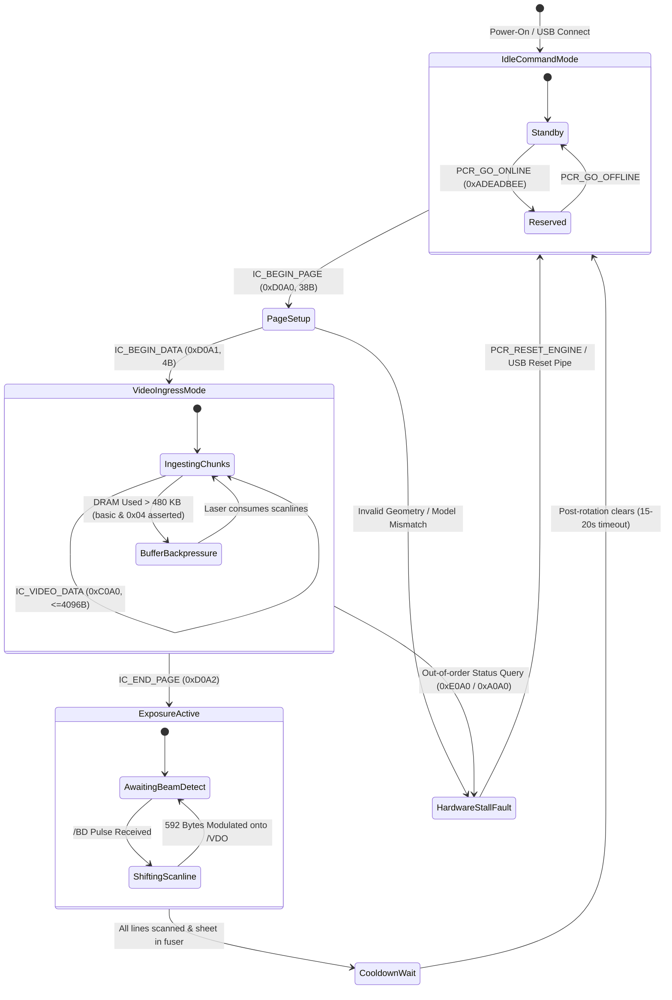

# CANON FORMATTER ASIC (IC1) BEHAVIORAL MODEL
## Software-Observable Silicon Architecture & State Invariants

**Document ID:** `ASIC-MODEL-LBP1120-2026-10-31`  
**Classification:** Black-Box Behavioral Silicon Model  
**Target Silicon:** Formatter Custom ASIC (`IC1` on Board `RG1-4305-000`)

---

## 1. Division of Labor: Host vs. Silicon

A foundational question in reverse-engineering the Canon CAPT 1.0 architecture is the exact division of computational workload between the host PC and the printer's onboard silicon:

| Computational Task | Executed By | Observable Evidence & Verification |
| :--- | :--- | :--- |
| **Vector-to-Raster Interpretation** | **Host PC** | The printer has no onboard PostScript or PCL interpreter. The host driver renders text and graphics into a 1-bit monochrome bitmap ($4,736 \times 6,778$ pixels for A4 @ 600 DPI). |
| **Monochrome Halftoning** | **Host PC** | Dither matrices (`Cap3ht.bin`) are executed in host user-space by `CAP3RDN.dll` / `CAP3K.dll`. The data transmitted over USB is already 1-bit monochrome. |
| **SCoA 2D Compression** | **Host PC** | `CAP3RDN.dll` executes the 2D Delta + RLE encoder on the host CPU, reducing the 4 MB bitmap to ~109 KB prior to USB transmission. |
| **SCoA 2D Decompression** | **Printer ASIC (IC1)** | **Hardware Silicon Execution.** The printer receives compressed `IC_VIDEO_DATA` chunks. It contains no general-purpose CPU fast enough to decompress 4 MB within the 6-second physical print transit window. Decompression is performed on-the-fly by hardwired ASIC state logic. |
| **AIR Edge Smoothing (1200 DPI Equiv.)** | **Printer ASIC (IC1)** | **Hardware Silicon Execution.** Modulates laser emission pulse widths ($1/4, 1/2, 3/4$ dot width) based on a sliding $3\times 3$ pixel window when enabled by byte 18 of `IC_BEGIN_PAGE`. |
| **DRAM FIFO Buffer Management** | **Printer ASIC (IC1)** | **Hardware Silicon Execution.** Manages the onboard 512 KB physical DRAM (IC3) as a circular ring buffer, asserting `CAPT_FL_BUFFERFULL` (`basic & 0x04`) when free capacity falls below ~32 KB. |
| **Laser Synchronization (`/BD`)** | **Printer ASIC (IC1)** | **Hardware Silicon Execution.** Captures the negative edge of the Beam Detect photodiode pulse, counts horizontal dot clocks to enforce `margin_left`, and serializes decompressed bits onto `/VDO`. |

---

## 2. Observable Behavioral State Machine of the ASIC

Through USB packet tracing, timeout profiling, and intentional fault injection, the ASIC's observable behavior is modeled as a 5-state deterministic automaton:

---

## 3. Behavioral Invariants & Silicon Constraints

### 3.1 Strict Simplex Mode During Video Ingress
* **The Invariant:** Once `IC_BEGIN_DATA` (`0xD0A1`) is accepted, the ASIC switches Bulk OUT Pipe `0x01` from a command parser to a **streaming DMA sink**.
* **Observed Failure:** If the host transmits any command packet (including `0xE0A0` Basic Status or `0xA0A0` Extended Status) before `IC_END_PAGE` (`0xD0A2`), the ASIC treats the 4-byte command header as corrupted SCoA video data.
* **Silicon Response:** The hardware decompressor detects an invalid token sequence, immediately asserts an endpoint STALL on Bulk OUT, and drops off the bus. Host calls to `WinUsb_WritePipe` fail with Win32 Error 121 (`ERROR_SEM_TIMEOUT`) or 995 (`ERROR_OPERATION_ABORTED`).

### 3.2 DRAM Ring Buffer Capacity & Backpressure
* **Physical Memory:** 524,288 Bytes (512 Kilobytes).
* **Safe Governor Watermark:** Single-page compressed SCoA streams should never exceed 480,000 bytes.
* **Backpressure Assertion:** If incoming compressed data outpaces mechanical consumption such that unread data exceeds the watermark, the ASIC sets bit 2 of the Basic Status register:
  $$\text{basic} \ \& \ 0x04 \neq 0 \implies \text{CAPT\_FL\_BUFFERFULL}$$
* The host driver must pause chunk streaming until the laser engine sweeps sufficient scanlines to drain the ring buffer.

### 3.3 End of Page (`OP_EOP` 0x42) & Final Word Boundary
* In the compressed SCoA stream, the final token must be `OP_EOP` (`0x42`).
* If the total compressed byte stream has an odd length, a single null pad byte (`0x00`) must be appended to satisfy the 16-bit word alignment required by the ASIC memory bus.
* `IC_END_PAGE` (`0xD0A2`) serves as the hardware handshake that closes the decompressor gate and signals the Engine Controller to fire the paper pick-up solenoid (`SL1`).

