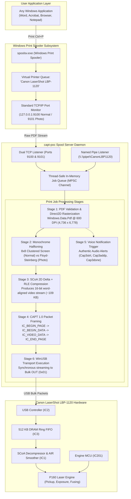

# COMPLETE PRINTING PIPELINE SPECIFICATION
## End-to-End Ingestion, Rasterization, Compression & USB Streaming

**Document ID:** `PIPE-SPEC-LBP1120-2026-10-31`  
**Classification:** Complete System Pipeline Specification  
**Architecture:** Windows Print Spooler $\rightarrow$ Rust Native Driver $\rightarrow$ WinUSB $\rightarrow$ Canon LBP-1120

---

## 1. End-to-End Data Pipeline Architecture

---

## 2. Detailed Pipeline Execution Stages

### Stage 1: Document Ingestion & WinRT Rasterization
- Ingestion occurs seamlessly via local loopback raw TCP (`127.0.0.1:9100` for Normal mode, `9101` for Photo mode) or Named Pipe (`\\.\pipe\CanonLBP1120`).
- The ingested document is validated for the PDF magic header (`%PDF-`).
- Multi-threaded COM MTA runtime invokes `Windows.Data.Pdf.PdfDocument`.
- Each vector page is rendered using Direct2D into an RGBA surface with dimensions exactly matching the physical A4 printable area at 600 DPI: **4,736 pixels wide $\times$ 6,778 scanlines high**.
- Automatic landscape-to-portrait orientation adjustment ensures no vector clipping occurs.

### Stage 2: 9-Mode Monochrome Halftoning Engine
The 8-bit continuous-tone grayscale raster is converted to a 1-bit monochrome bitmap ($592\text{ bytes/line}$) using one of nine specialized algorithms:
1. **Normal Mode (8×8 Clustered Dot Screen):** Uses Canon's proprietary cluster matrix extracted from `Cap3ht.bin`. Sharpens text and line graphics while resisting optical laser spot gain.
2. **Photo Mode (Serpentine Floyd-Steinberg):** 4-tap error-diffusion dithering with alternating left-to-right / right-to-left scanline propagation, eliminating visual worming artifacts in skin tones and gradients.
3. **Stucki 12-Tap:** High-fidelity photographic dithering with large diffusion kernel.
4. **Atkinson:** High-contrast economy toner-saver mode preserving highlights.
5. **Otsu Adaptive:** Dynamic bimodal thresholding for scanned black-and-white documents.

### Stage 3: SCoA 2D Delta + RLE Compression
- The 4,012,576 bytes of monochrome bitmap are compressed via `src/scoa.rs`.
- The encoder scans consecutive rows against a 592-byte reference cache, emitting `Copy`, `Repeat`, and `Raw` tokens.
- Execution completes in **7 to 9 milliseconds** on modern x64 hardware, producing an optimized video stream of approximately $109\text{ KB}$.
- Hardware invariants enforced: Total size $\le 480,000$ bytes; strictly padded to 16-bit word boundary; terminated by `OP_EOP` (`0x42`).

### Stage 4: CAPT 1.0 Packet Assembly & USB Streaming
- **`IC_BEGIN_PAGE` (`0xD0A0`, 38B):** Transmits target model (`0x01A4`), paper code (`2` for A4), resolution (`0x11` for 600 DPI), toner density (`31`), and margins (`112` left, `120` top).
- **`IC_BEGIN_DATA` (`0xD0A1`, 4B):** Instructs the Formatter ASIC to prepare its hardware decompressor.
- **`IC_VIDEO_DATA` (`0xC0A0`, 4,100B):** Streams the compressed SCoA bytes in 4,096-byte payload frames over Bulk OUT (0x01).
- **`IC_END_PAGE` (`0xD0A2`, 4B):** Concludes the page stream and signals the engine controller to energize the pickup solenoid.
