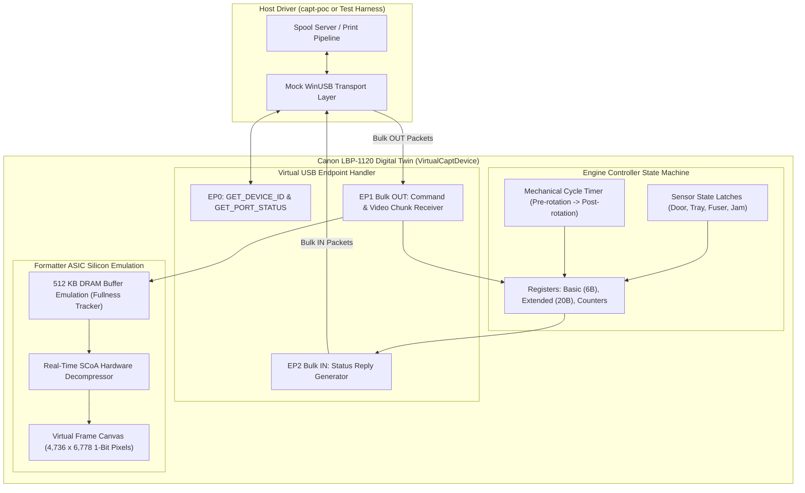

# DIGITAL TWIN & VIRTUAL HARDWARE SIMULATOR ARCHITECTURE
## Canon LaserShot LBP-1120 Software Emulation Platform

**Document ID:** `TWIN-ARCH-LBP1120-2026-10-31`  
**Classification:** Digital Twin Architecture & Virtual Device Simulation  
**Platform:** Pure Rust Virtual Device Emulator

---

## 1. Digital Twin Vision & Objectives

The Digital Twin is a software reproduction of the physical Canon LaserShot LBP-1120. It models the machine at four interconnected abstraction levels:

1. **Protocol & USB Transport Level:** Emulates Control Endpoint 0 (`GET_DEVICE_ID`, `GET_PORT_STATUS`), Bulk OUT Pipe 0x01, and Bulk IN Pipe 0x82 with microsecond packet framing.
2. **Silicon & Register Level:** Recreates the Formatter ASIC (`NH4-5014`) and Engine MCU (`HD6433292`) registers, including the 6-byte Basic register, 20-byte Extended status register, and 512 KB DRAM ring FIFO with backpressure logic.
3. **SCoA Hardware Decompression Level:** Ingests raw `IC_VIDEO_DATA` packets, parses SCoA tokens in real time, and decodes them into an internal virtual 600 DPI bitmap canvas ($4,736 \times 6,778$ pixels).
4. **Mechanical & Sensor State Machine:** Simulates the 5 physical periods (Standby, Pre-rotation warming, Pickup solenoid firing, Laser imaging, Fuser delivery, and Post-rotation cooldown) alongside virtual sensors (Paper Tray `PS202`, Delivery `PS201`, Door `SW301`).



---

## 2. Silicon Register & Telemetry Emulation

The Digital Twin maintains mutable hardware registers mirroring the physical printer:

```rust
pub struct VirtualDeviceRegisters {
    pub basic: u8,                   // Basic Status register (Byte 4)
    pub changed: u8,                 // Changed latches (Byte 5)
    pub aux: u8,                     // Aux register (feed solenoid / engine busy)
    pub controller: u8,              // Formatter flags
    pub paper_available_bits: u8,    // 0x80 = Paper present, 0x00 = Tray empty
    pub engine_raw: u16,             // 0x4000 = Door open, 0x2000 = Cartridge missing
    pub printed_pages: u8,           // Total printed sheets counter
    pub printing_pages: u8,          // Sheets currently moving through fuser
    pub shipped_pages: u8,           // Sheets delivered to exit tray
    pub start_pages: u8,             // Pickups initiated
}
```

### Dynamic State Invariants
- **Door Open:** When `door_open = true`, `engine_raw` sets bit `0x4000`. Any attempt to send `PCR_GO_ONLINE` fails with error response `0x80` (`DEVICE_ERROR`).
- **Paper Tray Empty:** When `paper_empty = true`, `basic` sets bit `0x02`, and `paper_available_bits` sets `0x00`.
- **FIFO Buffer Governor:** When unconsumed bytes in the virtual 512 KB DRAM exceed 480,000 bytes, `basic` sets bit `0x04` (`BUFFER_FULL`).

---

## 3. Real-Time SCoA Decoding to Virtual Canvas

When `IC_VIDEO_DATA` chunks arrive over virtual Bulk OUT, the Digital Twin feeds them directly into an embedded instance of `ScoaDecoder`. 

Upon receipt of `IC_END_PAGE` (`0xD0A2`):
1. The Digital Twin verifies that exactly 6,778 scanlines of 592 bytes each were decoded without framing errors.
2. The virtual pickup solenoid is triggered.
3. The mechanical simulation transitions through printing and post-rotation.
4. The decoded virtual page can be exported to disk as a bit-exact PBM image (`simulated_output.pbm`) for automated visual regression verification.

