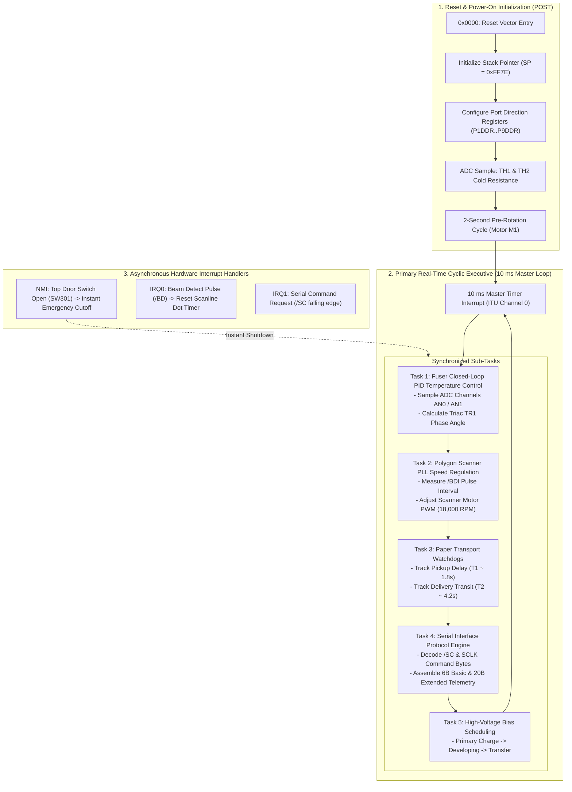

# ENGINE CONTROLLER FIRMWARE ARCHITECTURE & REAL-TIME SEQUENCER
## Software Reconstruction of Canon P160 Electrophotographic Engine Microcode

**Document ID:** `ENG-FW-ARCH-LBP1120-2026-10-31`  
**Classification:** Embedded Microcode & Real-Time Firmware Reconstruction  
**Target Processor:** Engine Microcontroller (`IC201` on Board `RG5-7264` / `RG5-7266`)  
**Architecture Platform:** Hitachi H8/300 Family Architecture

---

## 1. Real-Time Firmware Executive Model

The Engine Controller firmware executes a **strictly deterministic, cyclic executive architecture** synchronized to hardware timer interrupts and ADC conversion cycles. 

There is no dynamic memory allocation, no pre-emptive multi-tasking kernel, and no operating system overhead. The firmware manages physical electromechanical processes where timing jitter $> 1\text{ ms}$ would cause visible optical defects, unfused toner, or paper jams.



---

## 2. Thermal Regulation Microcode (Canon SURF Technology)

The fixing assembly utilizes a low-thermal-mass ceramic heater strip. Maintaining exact fusing temperature ($185^\circ\text{C} \pm 5^\circ\text{C}$) without thermal overshoot requires high-frequency closed-loop PID control:

### 2.1 Sensor Feedback
- **Main Thermistor (`TH1`):** Center of heater element; connected to ADC Channel AN0.
- **Sub-Thermistor (`TH2`):** Edge of heater element; connected to ADC Channel AN1 (detects edge temperature runaway during envelope or narrow media printing).
- **Sampling Frequency:** ADC conversions execute at 100 Hz (every 10 ms).

### 2.2 Triac Actuation & Firing Modes
- The Engine MCU controls Triac `TR1` (`BCR8KM`) via an optical triac driver to prevent AC line noise from coupling into the digital logic.
- **Zero-Crossing Control:** The MCU samples the AC line zero-crossing reference pulse.
- **Conduction Angle:** Current to the ceramic heater is pulsed in half-cycle AC wave bursts. During pre-rotation, the heater receives 100% duty cycle for ~4 seconds to reach $180^\circ\text{C}$; during printing, the duty cycle modulates between 25% and 65% depending on paper transit cooling.

### 2.3 Thermal Safety Watchdogs (Service Errors)
The firmware enforces three hardcoded thermal safety invariants:
1. **Low Temperature Error (`E000`):** If thermistor `TH1` fails to reach $100^\circ\text{C}$ within 6 seconds after triac engagement, the MCU halts all motors, cuts triac gate firing, and sets the service error latch.
2. **Abnormally High Temperature Error (`E001`):** If `TH1` measures $> 230^\circ\text{C}$ (indicating a shorted triac), the MCU triggers an immediate hardware NMI, cutting the +24V line. If digital control fails entirely, thermal fuse `TF1` permanently melts open at $228^\circ\text{C}$.
3. **Drop in Printing Temperature (`E003`):** If temperature drops below $140^\circ\text{C}$ during active printing, the engine pauses pickup to prevent smudged, unfused toner.

---

## 3. Polygon Scanner Motor PLL Synchronization

The 4-faceted polygon mirror must spin at exactly 18,000 RPM ($\pm 0.1\%$) to maintain horizontal line spacing for 600 DPI @ 10 PPM:

- **Scanline Period:**
  $$T_{\text{line}} = \frac{60\text{ seconds}}{18,000\text{ RPM} \times 4\text{ facets}} = \frac{60}{72,000} \approx 833.33\ \mu\text{s}$$
- **Speed Stabilization:**
  - The MCU issues acceleration (`/ACC`) and deceleration (`/DEC`) PWM pulses to the brushless driver IC on the scanner PCB.
  - The interval between consecutive `/BD` pulses is measured using a 16-bit hardware input capture timer.
  - If frequency lock is not achieved within **4.0 seconds**, the firmware shuts down the laser diode and logs error code **`E700`** (Polygon Scanner Motor Malfunction).

---

## 4. Paper Transport Watchdog State Automaton

To protect the mechanical paper path from accordion folds and fuser wrap jams, the firmware tracks sheet progression using millisecond watchdog timers:

```text
Pickup Solenoid SL1 Energized
      │
      ▼
[Start Timer T1: 1,800 ms] ──> Does Delivery Sensor PS201 trip before T1 expires?
                                 ├── NO  --> PICKUP DELAY JAM (Misfeed / Roller Slip)
                                 └── YES --> Sheet reached exit section
                                               │
                                               ▼
                                 [Start Timer T2: 4,200 ms] ──> Does PS201 reset before T2 expires?
                                                                  ├── NO  --> WRAP JAM (Paper wrapped around fixing sleeve)
                                                                  └── YES --> PRINT COMPLETE (Normal sheet ejection)
```

- When a jam is detected:
  1. Main Motor `M1` is powered down within 100 ms.
  2. High-voltage power supply biases are instantly collapsed to 0V.
  3. Fuser triac gate firing is disabled.
  4. The Jam flag (`engine_raw & 0x0100`) is latched and reported in Extended Status over USB.

---

## 5. What is Documented vs. What Remains Unknown

| Firmware Characteristic | Status in Canon Literature | Current Engineering Knowledge |
| :--- | :---: | :--- |
| **8-Bit CPU with on-chip ROM/RAM** | **DOCUMENTED** | Confirmed by Canon Service Manual Section 2.2. |
| **PID Fuser Control & E000-E003 Codes** | **DOCUMENTED** | Full error criteria and temperature thresholds documented. |
| **Paper Jam Watchdog Timers** | **DOCUMENTED** | Sensor trip intervals and jam recovery procedures documented. |
| **Exact Assembly Machine Code** | **UNKNOWN** | Etched into silicon mask ROM at semiconductor foundry; non-extractable via software. |
| **Exact Interrupt Vector Addresses** | **INFERRED** | Inferred from Hitachi H8/300 standard vector table (`0x0000..0x003F`). |
| **Internal Memory Scratchpad Map** | **INFERRED** | Inferred from H8/329 high-speed RAM layout (`0xFB80..0xFF7F`). |

