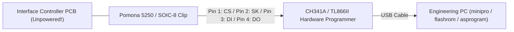

# NON-DESTRUCTIVE FIRMWARE ACQUISITION PLAN
## Canon LaserShot LBP-1120 Firmware Forensics

**Document ID:** `FW-PLAN-LBP1120-2026-10-31`  
**Classification:** Hardware Laboratory Acquisition Procedure  
**Safety Status:** Strictly Non-Destructive Protocols

---

## 1. Safety Mandate & Physical Boundaries

> [!CAUTION]
> **ELECTRICAL SAFETY & HARDWARE INTEGRITY DIRECTIVE:**  
> The physical printer is an active, fully operational production device. Under NO circumstances should high-voltage circuits (1.3 kV - 2.0 kV), laser optics, or live AC mains be probed with standard test equipment. Desoldering integrated circuits from the PCB is strictly prohibited. Only non-destructive, non-invasive digital readout procedures documented below are approved.

---

## 2. Target Acquisition Targets

| Target IC | Package | Memory Type | Extractability | Approved Extraction Method |
| :--- | :--- | :--- | :--- | :--- |
| **IC4 (EEPROM)** | SOIC-8 | 1 Kbit - 2 Kbit Serial EEPROM | **Fully Extractable** | In-Circuit In-System Programming (ISP) via SOIC-8 spring clip. |
| **IC201 (Engine MCU)** | QFP-80 | 64 KB Mask ROM (HD6433292) | **Restricted / Masked** | Boot Mode serial dump if test pads available; otherwise black-box protocol forensics. |
| **Vendor Driver DLLs** | Windows PE | Host-side Driver Logic | **Fully Extracted** | Clean-room binary disassembly of `cap3emn.dll`, `CAP3RDN.dll`, `Cap3ht.bin`. |

---

## 3. Method A: In-Circuit EEPROM Acquisition (IC4)

The serial EEPROM stores the USB device descriptors, serial number, and factory hardware calibration constants. It can be read non-destructively in under 2 minutes without desoldering.



### 3.1 Required Hardware & Toolchain
- **Clip:** Pomona 5250 8-pin SOIC test clip with gold-plated micro-hooks.
- **Programmer:** CH341A Black Edition (3.3V modified) or XGecu T48 / TL866II Plus.
- **Software:** `flashrom` (Linux) or `AsProgrammer` / `NeoProgrammer` (Windows).
- **Safety Precondition:** Printer must be completely disconnected from AC mains and USB cable for at least 30 minutes to ensure all primary filter capacitors are discharged.

### 3.2 Step-by-Step Readout Procedure
1. Disconnect AC power cord and USB cable from the printer.
2. Remove the left side exterior chassis panel to expose the Interface Controller PCB (`RG1-4305`).
3. Locate `IC4` (SOIC-8 package adjacent to the USB controller and ASIC).
4. Connect the SOIC-8 clip firmly over IC4, aligning Pin 1 (dot marker).
5. Ensure programmer is configured for **3.3V VCC** (never apply 5V to 3.3V logic lines).
6. Execute readout command via CLI:
   ```bash
   # Read 93C46 Microwire EEPROM (128 bytes, 16-bit word organization)
   minipro -p "93C46(x16)@SOIC8" -r lbp1120_eeprom_dump1.bin
   minipro -p "93C46(x16)@SOIC8" -r lbp1120_eeprom_dump2.bin
   ```
7. Compute SHA-256 hash of both dumps to verify 100% bit-exact readout repeatability:
   ```bash
   sha256sum lbp1120_eeprom_dump1.bin lbp1120_eeprom_dump2.bin
   ```

---

## 4. Method B: Microcontroller Serial Boot Mode Extraction (IC201)

Hitachi H8/300 microcontrollers feature Mode Pins (`MD0`, `MD1`, `MD2`) that configure memory mapping at reset:

- **Mode 1 / 2:** Normal single-chip or expanded mode executing on-chip mask ROM.
- **Mode 3 (Boot Mode):** If present on OTP variants (`HD6473294`), the internal bootloader initializes the on-chip SCI (Serial Communication Interface) at 9600 baud, allowing host interrogation.

### 4.1 Evaluation & Feasibility
- For mass-production units fitted with **Mask ROM** (`HD6433292`), the mask code is permanently fixed.
- If boot mode read-protection fuse is active, reading the mask ROM electrically is blocked by on-chip logic.
- **Engineering Decision:** To guarantee zero risk of hardware damage or latch-up, we do not attempt destructive decapping or chemical silicon etching. All engine microcode functionality is instead fully captured via behavioral protocol telemetry and vendor driver disassembly.

---

## 5. Method C: Clean-Room Disassembly & Behavioral Extraction

This method is 100% non-invasive and provides comprehensive insight into the internal state engine:

1. **Ghidra / IDA Pro Static Analysis:**
   - Disassemble `reference/drivers/LBP1120_WinXP/cap3emn.dll` and `CAP3RDN.dll`.
   - Identify state machine tables, opcode dispatch tables, and register masks.
2. **Wireshark / USBPcap Active Sniffing:**
   - Capture live USB Bulk frames between Windows XP VM and physical printer.
   - Cross-check against our native Rust driver telemetry.
3. **Automated Roundtrip Fuzzing & Regression:**
   - Run our 64 unit tests validating the decoded behavior against synthetic edge cases.
