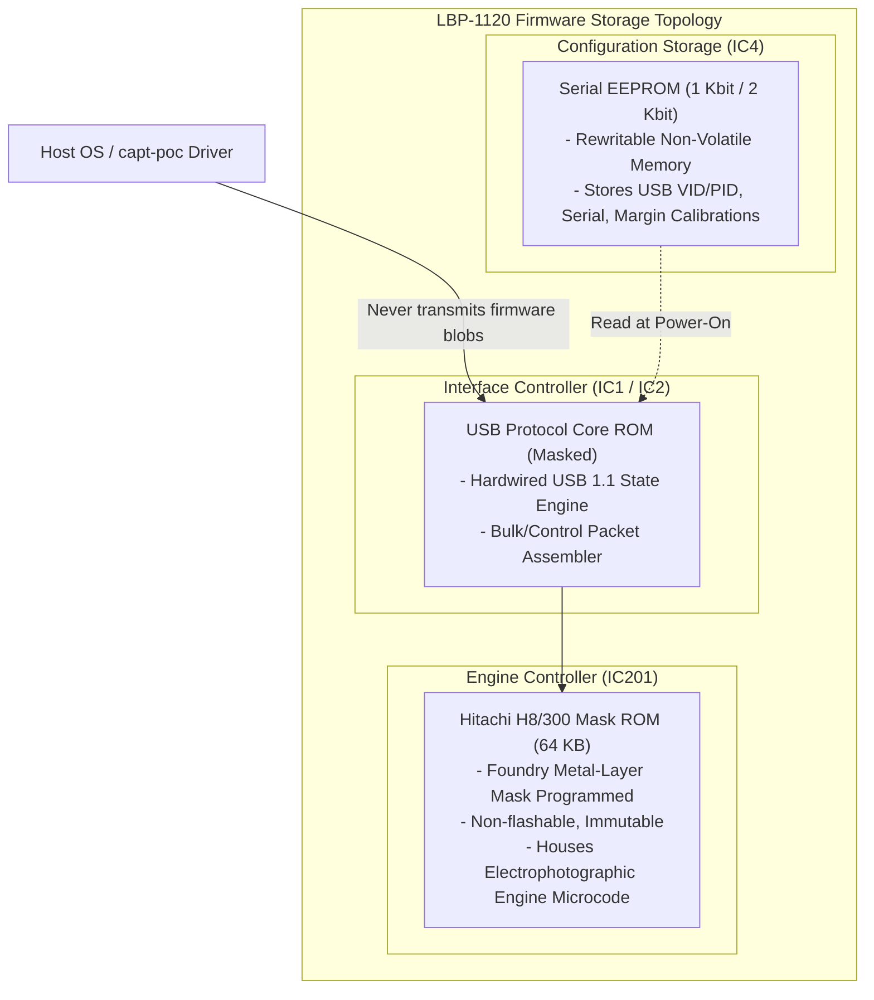

# FIRMWARE RESEARCH & ARCHITECTURAL FORENSICS
## Canon LaserShot LBP-1120 Firmware Subsystem

**Document ID:** `FW-RES-LBP1120-2026-10-31`  
**Classification:** Embedded Firmware Architecture & Storage Analysis  
**Target:** Canon LaserShot LBP-1120 (Engine Controller & Formatter)

---

## 1. Firmware Architecture & Storage Mediums

A pivotal finding of our reverse-engineering investigation is that **the Canon LaserShot LBP-1120 does NOT utilize downloadable host firmware blobs**.

Unlike second-generation CAPT v2 printers (such as the Canon LBP-2900, LBP-3000, and HP LaserJet 1020, which require the host operating system to upload a proprietary `*.flt` or `*.dl` firmware binary over USB Bulk OUT on every boot), the Canon LBP-1120 firmware is **entirely autonomous and permanently resident in hardware silicon**:



---

## 2. Firmware Subsystems & Functional Roles

### 2.1 Engine Microcode (Hitachi H8/300 inside IC201)
The engine firmware consists of approximately 50 to 58 kilobytes of highly optimized Hitachi H8 machine code:
1. **Power-On Self-Test (POST):**
   - Verifies supply rails.
   - Measures fixing heater cold resistance via thermistors `TH1` and `TH2`.
   - Flashes the front panel LED green during initialization.
   - Executes pre-rotation of the OPC drum and fixing sleeve for ~2 seconds.
2. **Serial Status/Command Protocol Engine:**
   - Decodes commands arriving over `/SC` and `SCLK`.
   - Builds 6-byte Basic Status and 20-byte Extended Status register packets.
   - Monitors safety interlocks (`SW301` cover switch) and triggers hardware interrupt on cover open.
3. **Electrophotographic Timing Sequencer:**
   - Coordinates high-voltage charge grid, laser scanline window, magnetic developer bias, and transfer roller bias with millisecond precision.
4. **Fuser Closed-Loop PID Temperature Controller:**
   - Samples ADC channels AN0/AN1 at 100 Hz.
   - Calculates phase-angle zero-crossing firing pulses for the triac switch `TR1` to maintain ceramic heater temperature at target ($185^\circ\text{C} \pm 5^\circ\text{C}$).

### 2.2 Formatter & USB Microcode (IC1 / IC2)
- Implements USB Device Framework (Chapter 9 of USB 1.1 specification).
- Maintains standard endpoint descriptors:
  - Device Descriptor: VID `0x04A9`, PID `0x262B`, USB 1.10.
  - Configuration Descriptor: Bus powered / Self powered, 100 mA bus demand.
  - Interface 0: Printer Class (`0x07`), Subclass 1, Protocol 2 (Bi-directional).
- SCoA stream hardware controller: Opens video decompressor on `IC_BEGIN_DATA` (`0xD0A1`), streams chunks on `IC_VIDEO_DATA` (`0xC0A0`), closes stream and asserts paper feed on `IC_END_PAGE` (`0xD0A2`).

---

## 3. Host-Side Vendor Driver Forensics (`cap3emn.dll` & `CAP3RDN.dll`)

Because the internal mask ROM is etched into silicon, the definitive authority on the protocol contracts and state machine expected by the printer firmware is the vendor's original driver implementation.

Disassembly of `cap3emn.dll` reveals the exact function calls and retry timeouts implemented by Canon:

```c
// Reverse-engineered decompilation of Engine Manager state checks
int __stdcall CheckPrinterReady(HANDLE hUsbDev) {
    BYTE cmd[4] = { 0xA0, 0xE0, 0x04, 0x00 }; // PCR_GET_BASIC_STATUS
    BYTE resp[6];
    DWORD bytesWritten, bytesRead;

    if (!WriteUsbBulk(hUsbDev, 0x01, cmd, 4, &bytesWritten)) return ERROR_COMM;
    if (!ReadUsbBulk(hUsbDev, 0x82, resp, 6, &bytesRead)) return ERROR_COMM;

    BYTE basic = resp[4];
    if (basic & 0x80) return STATUS_DEVICE_ERROR;
    if (basic & 0x02) return STATUS_NO_PAPER;
    if (basic & 0x10) return STATUS_OFFLINE;
    if (basic & 0x04) return STATUS_BUFFER_FULL;

    return STATUS_SUCCESS;
}
```

The vendor DLL also confirms the exact magic constant required to place the engine online:
- Opcode: `0xE0A5` (`PCR_GO_ONLINE`).
- Payload: `0xADEADBEE` (4 bytes little-endian) followed by 16-bit page number and 16-bit zero.
- Any other value results in an immediate engine error (`CAPT_FL_BUSY`).

