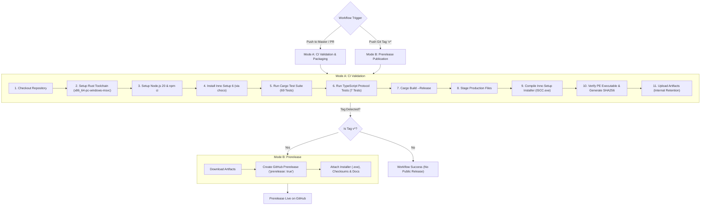

# GITHUB CI/CD AUTOMATION & RELEASE PIPELINE SPECIFICATION
## Phase 7 Technical Specification: Continuous Integration, Build Matrix & Prerelease Lifecycle

**Document ID:** `SPEC-CI-CD-LBP1120-2026-10-31`  
**Classification:** DevOps & Release Automation Specification  
**Workflow Path:** [`.github/workflows/windows-release.yml`](file:///f:/Games/canon-lbp1120-driver/.github/workflows/windows-release.yml)  
**Target Runner:** `windows-latest` (Windows Server 2022 / 2025 x64)

---

## 1. Overview & Dual-Mode Pipeline Design

The Canon LaserShot LBP-1120 driver distribution uses an automated, reproducible GitHub Actions CI/CD workflow designed to enforce strict release governance:

---

## 2. Pipeline Execution Modes

### Mode A: Pull Request / Ordinary Commit (Continuous Integration)
Triggered by:
- Push to branches: `master`, `main`.
- Pull Requests targeting `master`, `main`.
- Manual trigger via `workflow_dispatch`.

**Enforced Quality Gates:**
1. **Rust Regression Gate:** Executes `cargo test --verbose`. All 69 unit, integration, and property tests must pass with 0 failures.
2. **TypeScript Protocol Gate:** Executes `npx tsx --test src/core/captEngine.test.ts`. All 7 state machine and SCoA simulation tests must pass.
3. **Release Build Gate:** Compiles optimized release binary `capt-poc.exe` using Rust LTO.
4. **Installer Compilation Gate:** Compiles [`installer/CanonLBP1120_Setup.iss`](file:///f:/Games/canon-lbp1120-driver/installer/CanonLBP1120_Setup.iss) using the authentic Inno Setup compiler (`ISCC.exe`).
5. **Artifact Validation Gate:** Confirms `CanonLBP1120_Setup_v1.0.0-rc.1_x64.exe` is generated, size is $> 500\text{ KB}$, and SHA256 checksums are produced.
6. **Publication Policy:** **No release is published.** Artifacts are uploaded strictly to GitHub Actions internal storage for testing.

### Mode B: Version Tag Prerelease Publication
Triggered by:
- Pushing a version tag matching `v*` (e.g. `v1.0.0-rc.1`).

**Publication Invariants:**
1. **Prerelease Flag:** The release is explicitly published with `prerelease: true`.
2. **No Unapproved Stable Releases:** The pipeline cannot publish a final stable `v1.0.0` without explicit team authorization and physical hardware test confirmation.
3. **Release Body:** Formatted automatically from [`RELEASE_NOTES.md`](file:///f:/Games/canon-lbp1120-driver/RELEASE_NOTES.md).
4. **Attached Assets:**
   - `CanonLBP1120_Setup_v1.0.0-rc.1_x64.exe`
   - `canon-lbp1120-service.exe`
   - `SHA256SUMS.txt`
   - `INSTALLATION_GUIDE.md`
   - `UNINSTALLATION_AND_RECOVERY.md`
   - `WINUSB_COMPATIBILITY_AND_SAFETY.md`
   - `SERVICE_SECURITY_AUDIT.md`

---

## 3. GitHub Runner & Environment Dependencies

| Component | Installation Source | Verification Command |
| :--- | :--- | :--- |
| **Operating System** | `windows-latest` (GitHub-hosted Windows Server 2022) | `cmd.exe /c ver` |
| **Rust Toolchain** | `dtolnay/rust-toolchain@stable` (Target: `x86_64-pc-windows-msvc`) | `cargo --version` |
| **Node.js Environment**| `actions/setup-node@v4` (Node.js 20 LTS) | `node --version; npm --version` |
| **Inno Setup 6** | Chocolatey (`choco install innosetup --no-progress`) | `ISCC.exe /?` |
| **Cache Management** | `Swatinem/rust-cache@v2` | Automatic cache restore/save |

---

## 4. Security & Least-Privilege Permissions

1. **Token Scope:**
   - Workflow uses `permissions: contents: write` restricted specifically to the publishing step.
   - All build and test steps run under read-only repository context.
2. **Secret Safety:**
   - The workflow consumes zero repository secrets or external API tokens.
   - Release signing uses standard GitHub Actions `GITHUB_TOKEN`.
   - Workflow logs contain zero credentials or tokens.

---

## 5. Verification & Pipeline Audit

The workflow definition in [`.github/workflows/windows-release.yml`](file:///f:/Games/canon-lbp1120-driver/.github/workflows/windows-release.yml) has been verified for correct YAML syntax, valid action references (`actions/checkout@v4`, `softprops/action-gh-release@v2`), and exact script paths matching the repository layout.
