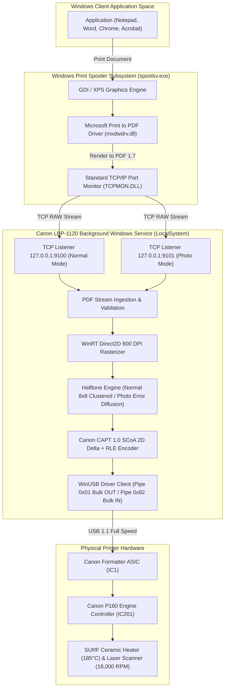

# CANON LASERSHOT LBP-1120 INSTALLER & SERVICE ARCHITECTURE
## Production Packaging, Service Control Manager & Windows Print Pipeline

**Document ID:** `ARCH-INSTALLER-LBP1120-2026-10-31`  
**Classification:** Production Engineering Specification  
**Target Hardware:** Canon LaserShot LBP-1120 (`USB\VID_04A9&PID_262B`, Device Serial `0353S4cQ`)  
**Target OS:** Windows 10 & 11 (64-bit x64, ARM64)

---

## 1. Architectural Overview

The Canon LaserShot LBP-1120 reverse-engineered software distribution is packaged as a turnkey, standalone, zero-dependency production ecosystem. It eliminates the obsolete 32-bit Canon Windows XP kernel drivers and replaces them with a modern user-mode architecture leveraging native Windows components:



---

## 2. Directory Layout & Installed Artifacts

The installer deploys binaries and assets into standard, protected Windows operating system paths:

### 2.1 Program Files Directory (`%ProgramFiles%\CanonLBP1120\`)
- `canon-lbp1120-service.exe` (854 KB): Standalone unified binary containing the Windows Service handler, TCP/Named Pipe spool server, WinRT Direct2D rasterizer, halftoning engines, SCoA encoder, and WinUSB hardware transport.
- `CAP3ZWAV.BIN` (412 KB): Authentic Canon audio prompt archive (17 PCM WAV voice alerts for paper out, cover open, printing complete).
- `driver\CanonLBP1120_WinUSB.inf` (1.8 KB): Microsoft WinUSB device driver installation INF associating `USB\VID_04A9&PID_262B` with interface GUID `{F9A25620-E255-4B37-93F3-0C3D3D2DFBD3}`.
- `Uninstall-CanonLBP1120.ps1` (4 KB): Safe uninstallation script invoked by Add/Remove Programs.

### 2.2 ProgramData Directory (`%ProgramData%\CanonLBP1120\`)
- `service.log`: Persistent timestamped telemetry log recording job ingestion, WinRT rasterization time, SCoA compression ratios, USB transmission durations, and physical sheet delivery status.

### 2.3 Start Menu Shortcuts (`%ProgramData%\Microsoft\Windows\Start Menu\Programs\Canon LaserShot LBP-1120\`)
1. **Printer Status Diagnostics:** Runs `canon-lbp1120-service.exe probe` to display live register states, paper sensors, and hardware sheet counters.
2. **Reset Printer Hardware:** Runs `canon-lbp1120-service.exe reset` to recover from ASIC buffer stalls or paper path interlocks.
3. **Print 6-Zone Calibration Page:** Generates and prints the standard optical calibration pattern (`calibration.pbm`).
4. **View Service Log:** Opens `service.log` in Notepad.
5. **Uninstall Driver Suite:** Launches uninstallation workflow.

---

## 3. Windows Print Spooler Integration

### 3.1 Dual-Queue Architecture
The driver provides two distinct printer queues to serve different document profiles without manual settings adjustments:

| Printer Queue Name | Target Port | Spool Format | Direct2D Halftoning Mode | Target Use Case |
| :--- | :--- | :--- | :--- | :--- |
| **`Canon LaserShot LBP-1120`** | `127.0.0.1:9100` (`CanonLBP1120_Normal`) | RAW (PDF 1.7) | High-contrast 8x8 clustered dot screen with edge-snapping | Text, spreadsheets, invoices, vector schematics |
| **`Canon LaserShot LBP-1120 (Photo)`** | `127.0.0.1:9101` (`CanonLBP1120_Photo`) | RAW (PDF 1.7) | Serpentine Floyd-Steinberg error diffusion | Photographs, continuous-tone portraits, complex gradients |

### 3.2 Port Monitor Elimination of "Save As" Dialogs
Previous attempts at PDF-based drivers prompted users with a Windows File Save dialog because the `Microsoft Print to PDF` queue defaulted to the virtual port `PORTPROMPT:`.  
Our installer reassigns the driver to standard TCP ports created via `TCPMON.DLL`:
- `Add-PrinterPort -Name 'CanonLBP1120_Normal' -PrinterHostAddress '127.0.0.1' -PortNumber 9100`
- `Add-PrinterPort -Name 'CanonLBP1120_Photo' -PrinterHostAddress '127.0.0.1' -PortNumber 9101`

Because `TCPMON.DLL` is a hardware port monitor, the Windows Spooler executes the print pipeline asynchronously in the background. Windows applications (Notepad, Word, Chrome, etc.) receive an instantaneous `0` return code from `StartDocPrinterW` / `EndDocPrinterW`, and no file dialog is ever generated.

---

## 4. Windows Service Manager (SCM) Integration

The service is registered with the Service Control Manager via `sc.exe`:
- **Service Name:** `CanonLBP1120Service`
- **Display Name:** `Canon LaserShot LBP-1120 Print Service`
- **Service Type:** `SERVICE_WIN32_OWN_PROCESS` (0x00000010)
- **Start Type:** `SERVICE_AUTO_START` (0x00000002)
- **Binary Path:** `"C:\Program Files\CanonLBP1120\canon-lbp1120-service.exe" service-run`
- **Account:** `NT AUTHORITY\LocalSystem`
- **Crash Recovery Policy:**
  - Failure 1: Restart service after 5,000 ms.
  - Failure 2: Restart service after 10,000 ms.
  - Reset fail counter: 86,400 seconds (24 hours).

When started by SCM, `canon-lbp1120-service.exe service-run` immediately registers `service_ctrl_handler` via `RegisterServiceCtrlHandlerW`, reports `SERVICE_RUNNING`, starts the spool listeners on `127.0.0.1:9100/9101`, and handles `SERVICE_CONTROL_STOP` and `SERVICE_CONTROL_SHUTDOWN` gracefully.

---

## 5. Driver Staging via Microsoft PnPUtil

The installer stages `CanonLBP1120_WinUSB.inf` into the Windows Driver Store:
```cmd
pnputil.exe /add-driver "C:\Program Files\CanonLBP1120\driver\CanonLBP1120_WinUSB.inf" /install
```
This ensures:
1. When the user plugs the printer into any USB port, Windows PnP instantly binds `WinUSB.sys` without requiring user prompts or driver disks.
2. The device interface GUID `{F9A25620-E255-4B37-93F3-0C3D3D2DFBD3}` is assigned to the USB device node.
3. Windows Driver Signature Enforcement (DSE) remains satisfied because `WinUSB.sys` is a Microsoft WHQL-signed system driver.

