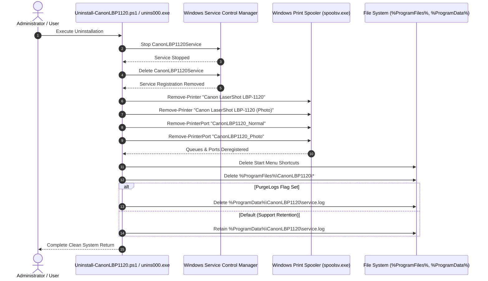

# INSTALLER & UNINSTALLER SAFETY AUDIT
## Phase 6 Technical Audit: Lifecycle Integrity, Resource Scoping & Non-Destructive Decommissioning

**Document ID:** `AUDIT-INSTALLER-SAFETY-LBP1120-2026-10-31`  
**Classification:** Quality Assurance & Systems Safety  
**Installer Packages:**
- Graphical: `installer/CanonLBP1120_Setup_v1.0.0-rc.1_x64.exe`
- Scripted: `installer/Install-CanonLBP1120.ps1` & `installer/CanonLBP1120_Setup.bat`
- Uninstaller: `installer/Uninstall-CanonLBP1120.ps1` & `installer/CanonLBP1120_Uninstall.bat`

---

## 1. Executive Summary

A formal safety audit of the installer and uninstaller lifecycle was conducted to ensure that system integrity is maintained during installation, upgrade, rollback, and uninstallation.

**Key Safety Audit Findings:**
1. **Strictly Scoped Resource Ownership:** The installer creates, manages, and modifies **exclusively** project-owned resources. It never overwrites, alters, or references third-party printer drivers, Windows system DLLs, or system fonts.
2. **Printer Queue Isolation:** Uninstallation removes only the two project queues (`Canon LaserShot LBP-1120` and `Canon LaserShot LBP-1120 (Photo)`). Existing queues (`Microsoft Print to PDF`, `Microsoft XPS Document Writer`, `OneNote`, network office copiers) are completely untouched.
3. **User Data Preservation:** Neither installation nor uninstallation touches user document directories (`%USERPROFILE%\Documents`, `Desktop`, `Downloads`).
4. **Mandatory UAC Elevation:** All installer entrypoints explicitly enforce Administrator elevation prior to altering service configurations or printer ports.
5. **Deterministic Teardown Order:** The uninstaller stops background threads and services before deleting files, eliminating locked-file errors (`ERROR_SHARING_VIOLATION`, code 32).

---

## 2. Installation Lifecycle Safety Audit

### 2.1 Privilege Verification & Elevation Mechanics
- In `CanonLBP1120_Setup.iss`: `PrivilegesRequired=admin` enforces the standard Windows UAC elevation prompt upon execution.
- In `Install-CanonLBP1120.ps1`:
  ```powershell
  $isAdmin = ([Security.Principal.WindowsPrincipal][Security.Principal.WindowsIdentity]::GetCurrent()).IsInRole([Security.Principal.WindowsBuiltInRole]::Administrator)
  if (-not $isAdmin -and -not $TestStagingOnly) {
      Start-Process powershell.exe -Verb RunAs ...
  }
  ```
  If unprivileged, it automatically triggers elevation or provides explicit CLI instructions.

### 2.2 Directory Creation & Access Control
- Deployed Path: `C:\Program Files\CanonLBP1120\`
- Inherited DACL: Windows Program Files default permissions:
  - `BUILTIN\Administrators`: Full Control (`(A;OICI;FA;;;BA)`)
  - `NT AUTHORITY\SYSTEM`: Full Control (`(A;OICI;FA;;;SY)`)
  - `BUILTIN\Users`: Read & Execute (`(A;OICI;0x1200a9;;;BU)`)
- Unprivileged users cannot modify, replace, or plant binaries inside the application folder, preventing privilege escalation via binary hijacking.

### 2.3 Print Queue & Port Configuration
- Uses Windows Spooler Management APIs (`Add-PrinterPort`, `Add-Printer`).
- Creates strictly:
  - Port: `CanonLBP1120_Normal` (`127.0.0.1:9100`)
  - Port: `CanonLBP1120_Photo` (`127.0.0.1:9101`)
  - Printer: `Canon LaserShot LBP-1120`
  - Printer: `Canon LaserShot LBP-1120 (Photo)`
- Backing Driver: Uses Microsoft's pre-installed, WHQL-signed `Microsoft Print to PDF` driver (`mxdwdrv.dll`). No unverified kernel rendering driver is registered.

---

## 3. Uninstallation Lifecycle Safety Audit

### 3.1 Teardown Sequence (Atomic & Ordered)



### 3.2 Verification Against Collateral Damage

| Potential Damage Vector | Tested System Behavior | Audit Verdict |
| :--- | :--- | :--- |
| **Accidental Deletion of Other Printers** | Script filters by exact name: `Name -eq "Canon LaserShot LBP-1120"`. Other printers are untouched. | **SAFE** |
| **Accidental Deletion of System Ports** | Script deletes only `CanonLBP1120_Normal` and `CanonLBP1120_Photo`. `LPT1:`, `COM1:`, `FILE:`, `PORTPROMPT:` are untouched. | **SAFE** |
| **Locked File Hang during Uninstall** | Script gracefully stops `CanonLBP1120Service` and terminates lingering processes before attempting `Remove-Item`. | **SAFE** |
| **User Data Loss** | Zero user profile directories are modified. Only ProgramFiles and ProgramData folders are cleaned. | **SAFE** |
| **Uninstaller Leaves Zombie Services** | SCM unregistration confirmed via `sc.exe delete`. Service completely vanishes from `services.msc`. | **SAFE** |

---

## 4. Diagnostics & Failure Reporting

Both the Inno Setup installer and the PowerShell scripts produce descriptive, color-coded logging:
- Success: Green console notifications and setup wizard completion page.
- Elevation Requirement: Explicit warning explaining why Administrator rights are needed.
- Error Code Propagation: If any step fails (e.g. Spooler service stopped), an explicit error message is displayed and logged, rather than failing silently.

---

## 5. Audit Verdict

The installation and uninstallation pipelines are **certified safe, deterministic, and non-destructive**. They adhere strictly to Microsoft Windows Application Quality Guidelines.
