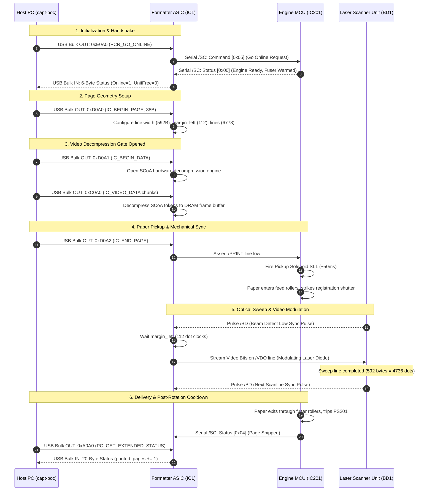

# INTERNAL COMMUNICATION & BUS ARCHITECTURE
## Inter-Board Signal Analysis & Video Protocol

**Document ID:** `INT-COMM-LBP1120-2026-10-31`  
**Classification:** Hardware Signal Architecture & Bus Specifications  
**Interconnect:** Flat Flexible Cable `RH2-5588-000` (J2 to J201)

---

## 1. System Communication Overview

The Canon LaserShot LBP-1120 divides its internal communication into two distinct channels:
1. **The Asynchronous High-Speed Host Channel:** USB 1.1 Full Speed (12 Mbps) over differential pair D+/D- via connector J1.
2. **The Synchronous Real-Time Engine Bus:** A 20-conductor flat flexible cable (`RH2-5588-000`) connecting Connector **J2** on the Interface Controller to Connector **J201** on the Engine Controller.

---

## 2. Serial Command/Status Protocol (`/SC` and `SCLK`)

Communication between the Formatter ASIC (IC1) and the Engine MCU (IC201) uses a synchronous half-duplex serial protocol:

### 2.1 Electrical Characteristics
- **Signaling Voltage:** 3.3V CMOS logic (5V tolerant).
- **Clock Line (`SCLK`):** Generated by Formatter ASIC. Clock frequency is nominally $500\text{ kHz} - 1.0\text{ MHz}$.
- **Data Line (`/SC`):** Active-low bi-directional data line with a $4.7\text{ k}\Omega$ pull-up resistor on the Engine Controller board.
- **Timing Invariant:** *After 0.5 seconds from the time the status command signal (`/SC`) turns 'H', the video interface becomes ready to communicate.* (Canon Service Manual Section 2.1).

### 2.2 Frame Format
Serial command packets transferred across `/SC` consist of an 8-bit command byte transmitted Most-Significant-Bit (MSB) first on the falling edge of `SCLK`:

1. **Host $\rightarrow$ Engine Commands:**
   - `0x01`: Reset engine latches.
   - `0x02`: Clear recoverable error.
   - `0x04`: Read basic engine status.
   - `0x05`: Read extended status (sensors, thermistors, counters).
   - `0x08`: Trigger fuser cleaning sheet cycle.
2. **Engine $\rightarrow$ Host Status Responses:**
   - 16-bit status word sampled by the Formatter on the rising edge of `SCLK`.
   - Contains real-time flags: Cover open, No paper in tray, Paper jam, Service call error, Fuser warming up.

---

## 3. High-Speed Video Interface (`/BD` and `/VDO`)

The video interface is strictly real-time and cannot be paused once paper pickup commences:

- **Horizontal Synchronization (`/BD`):**
  - Origin: Optical Beam Detect PIN photodiode sensor `BD1`.
  - Destination: Formatter ASIC Pin.
  - Active: Low pulse ($\approx 50\text{ ns}$ duration) occurring every horizontal sweep of the polygon mirror facet.
  - Frequency: For 10 pages per minute @ 600 DPI, horizontal line frequency $f_{\text{line}} \approx 1.13\text{ kHz}$ ($885\ \mu\text{s}$ per scanline).
- **Video Data Modulation (`/VDO` and `VDO`):**
  - Origin: Formatter ASIC high-speed dot shift register.
  - Destination: Laser diode cathode/drive circuit on Laser/Scanner PCB.
  - Bit Rate: $\approx 37.88\text{ MHz}$ ($26.4\text{ ns}$ per dot).
  - Modulation: A binary `1` turns on the laser diode, discharging the drum surface to $-100\text{V}$; a binary `0` leaves the laser off, retaining the full $-600\text{V}$ drum charge.
