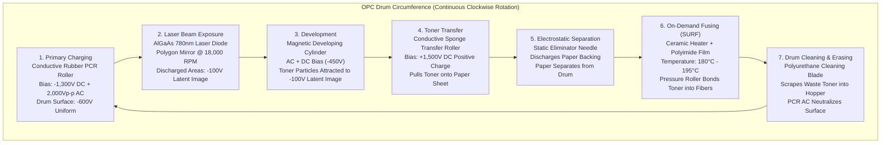

# MECHANICAL ARCHITECTURE & ELECTROPHOTOGRAPHIC SPECIFICATION
## Canon LaserShot LBP-1120 Engine Mechanics

**Document ID:** `MECH-ARCH-LBP1120-2026-10-31`  
**Classification:** Mechanical Engineering & Electrophotographic Process  
**Engine Platform:** Canon P160 Engine (Canon EP-22 / HP C4092A Cartridge Platform)

---

## 1. The 7-Stage Electrophotographic Process

The Canon LaserShot LBP-1120 utilizes the Canon P160 electrophotographic engine, implementing the classic dry-toner laser printing cycle in seven synchronized physical stages:

### Stage 1: Primary Charging
The Primary Charge Roller (PCR)—a conductive synthetic rubber roller—maintains continuous contact with the Organic Photoconductor (OPC) drum. The high-voltage power supply applies a $-1,300\text{V}$ DC bias with a superimposed $2,000\text{V}_{\text{p-p}}$ AC ripple. This produces uniform micro-plasma discharges in the tiny air gap adjacent to the contact nip, coating the drum's photosensitive organic layer with a stable, uniform negative charge of **$-600\text{V}$**.

### Stage 2: Laser Exposure
An aluminum-gallium-arsenide (AlGaAs) semiconductor laser diode emits a concentrated $780\text{ nm}$ near-infrared beam. The beam passes through a collimating lens, a cylindrical lens, and strikes a 4-faceted aluminum polygon mirror spinning at 18,000 RPM. As each mirror facet sweeps the beam horizontally through an f-$\theta$ optical lens, it scans across the drum surface. 

Where the laser strikes the photoconductive drum, photons generate electron-hole pairs, discharging the surface potential from **$-600\text{V}$ down to $-100\text{V}$**. Areas not struck by the laser maintain their full $-600\text{V}$ charge. This creates a high-resolution electrostatic latent image on the drum.

### Stage 3: Development
The development assembly consists of a stationary internal permanent magnet core surrounded by a rotating aluminum developing sleeve coated with a conductive resin. Single-component magnetic toner (iron-oxide cores encased in styrene-acrylic resin particles with silica anti-caking agents) is metered onto the sleeve by a polyurethane doctor blade. 

Friction against the blade charges the toner particles negatively. An AC bias with a $-450\text{V}$ DC offset is applied to the sleeve. Because the exposed latent image on the drum is at $-100\text{V}$ (less negative than the sleeve's $-450\text{V}$), negative toner particles jump across the development gap to adhere to the exposed latent image while being electrostatically repelled from the unexposed $-600\text{V}$ background.

### Stage 4: Transfer
As the paper sheet is fed between the drum and the conductive sponge Transfer Roller, a high-voltage positive bias (**$+1,500\text{V}$**) is applied to the transfer roller. This positive charge on the backside of the paper sheet exerts an electrostatic attraction that overcomes the surface adhesion of the toner to the OPC drum, drawing the toner powder cleanly onto the paper fibers.

### Stage 5: Separation
The high positive charge on the paper tends to cause it to cling electrostatically to the grounded aluminum base of the drum. To prevent jams, a discharge needle array (grounded or slightly negatively biased) sprays ions onto the backside of the sheet immediately after the transfer nip, neutralizing the charge. The paper's mechanical beam stiffness naturally separates it from the curve of the drum.

### Stage 6: Fixing (Fusing) — Canon SURF Technology
Rather than utilizing a power-hungry, high-thermal-inertia halogen lamp inside a thick metal roller, the LBP-1120 uses Canon's patented **SURF (Surface Rapid Fusing)** on-demand fixing technology:
- **Heater Element:** An ultra-thin ceramic substrate with a screen-printed silver-palladium resistive trace.
- **Fixing Sleeve:** A seamless, flexible tubular polyimide film coated with a fluoropolymer (PTFE) non-stick exterior.
- **Pressure Roller:** A soft silicone rubber roller exerting continuous spring pressure against the ceramic heater.
- **Thermal Behavior:** The ceramic heater has negligible thermal mass, heating from ambient ($20^\circ\text{C}$) to fusing temperature ($185^\circ\text{C}$) in **less than 8 seconds**. When the toner-bearing paper passes through the nip, toner resins liquefy and are permanently pressed into the cellulose paper matrix.

### Stage 7: Drum Cleaning
After transfer, a small fraction of toner remains on the drum surface. A sharp polyurethane cleaning blade scrapes this residual toner off the rotating drum, depositing it into the internal waste hopper within the EP-22 cartridge. The drum then rotates back under the PCR to begin the cycle again.
