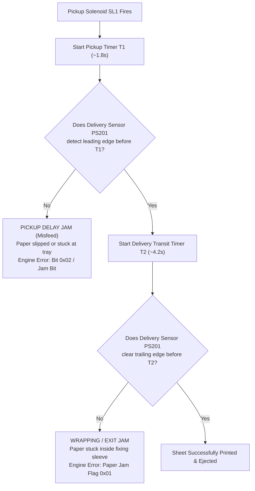

# MECHANICAL FAILURE MODES & SENSOR TELEMETRY
## Canon LaserShot LBP-1120 Fault Forensics

**Document ID:** `MECH-FAIL-LBP1120-2026-10-31`  
**Classification:** Mechanical Fault Analysis & Diagnostic Telemetry  
**Scope:** Paper Transport Jams, Sensor Failure States, and Service Call Errors

---

## 1. Paper Transport Faults & Jam Detection

The Engine MCU (IC201) maintains continuous hardware watchdog timers tracking paper edge transitions between optical sensors:

### 1.1 Pickup Delay Jam (Misfeed)
- **Symptom:** Solenoid clicks, motor runs, but no paper leaves the cassette.
- **Cause:** Worn rubber D-cut pickup roller (loss of tackiness), worn separation pad, or paper tray empty sensor mechanical flag sticking.
- **Hardware Telemetry:** In Extended Status, `paper_jam` asserts, and `basic` register sets `0x80` (`CAPT_FL_BUSY`).
- **Recovery:** Open top cover, inspect pickup area, clear jammed sheet, close cover. Driver issues `PCR_CLEAR_MISPRINT` (`0xE0A3`) and `PCR_CLEAR_ERROR` (`0xE0A2`).

### 1.2 Fixing Assembly Delivery Jam
- **Symptom:** Paper feeds halfway through the top exit tray and stops; printer halts immediately.
- **Cause:** Paper wraps around fixing film (due to electrostatic cling or melted toner), torn polyimide sleeve, or worn delivery roller gears.
- **Safety Action:** The MCU instantly cuts triac gate firing and stops the main motor within 100 ms to prevent paper scorch.

---

## 2. Thermal & Fuser Protection Faults (Service Call Errors)

The fixing assembly contains dual thermistors (`TH1` main thermistor at center, `TH2` sub-thermistor at edge) and a thermal fuse (`TF1`):

| Error Code | Official Designation | Physical Condition | Safety Mitigation |
| :--- | :--- | :--- | :--- |
| **`E000`** | Fixing Unit Low Temperature Error | Ceramic heater fails to reach 100°C within 6 seconds after triac engagement. | Triac disabled; service error bit latched in NVRAM; requires power cycling. |
| **`E001`** | Fixing Unit Abnormally High Temp | Thermistor TH1 reads $> 230^\circ\text{C}$ (indicating shorted triac). | Immediate cut of 24V and AC line; thermal fuse TF1 permanently melts open at 228°C if electronics fail. |
| **`E003`** | Fixing Unit Low Temp During Print | Fuser temperature drops below 140°C during continuous multi-page printing. | Engine halts print job to prevent unfused loose toner contamination. |
| **`E700`** | Polygon Scanner Motor Error | Scanner motor fails to achieve frequency lock at 18,000 RPM within 4 seconds. | Laser emission inhibited; scanner motor power removed. |

---

## 3. Sensor State Mapping & Bitfield Translation

| Physical Condition | Direct Hardware Sensor | Status Packet | Bitfield / Register Value | Verified Voice Event |
| :--- | :--- | :--- | :--- | :--- |
| **Paper Tray Empty** | `PS202` (Photointerrupter) | Basic Status (`0xE0A0`) | `basic & 0x02 != 0` | `"Load paper into the printer"` (`Cap3addp.wav`) |
| **Paper Inserted into Tray**| `PS202` (Flag lifted) | Extended Status (`0xA0A0`) | `(payload[2] & 0x80) != 0` | `"Paper loaded, resuming..."` (`Cap3come.wav`) |
| **Top Door / Cover Open** | `SW301` (Microswitch) | Extended Status (`0xA0A0`) | `(engine_raw & 0x4000) != 0` | `"Printer error occurred"` (`Cap3err.wav`) |
| **Toner Cartridge Missing** | Optical / Antenna Sense | Extended Status (`0xA0A0`) | `(engine_raw & 0x2000) != 0` | `"Printer error occurred"` (`Cap3err.wav`) |
| **Active Printing Cycle** | Main Motor / Laser | Basic Status (`0xE0A0`) | `basic & 0x01 != 0` | `"Printing has started"` (`Cap3strt.wav`) |
| **Page Ejection Complete** | `PS201` (Flag reset) | Extended Status (`0xA0A0`) | `printed_pages` incremented | `"Print job completed"` (`Cap3done.wav`) |
