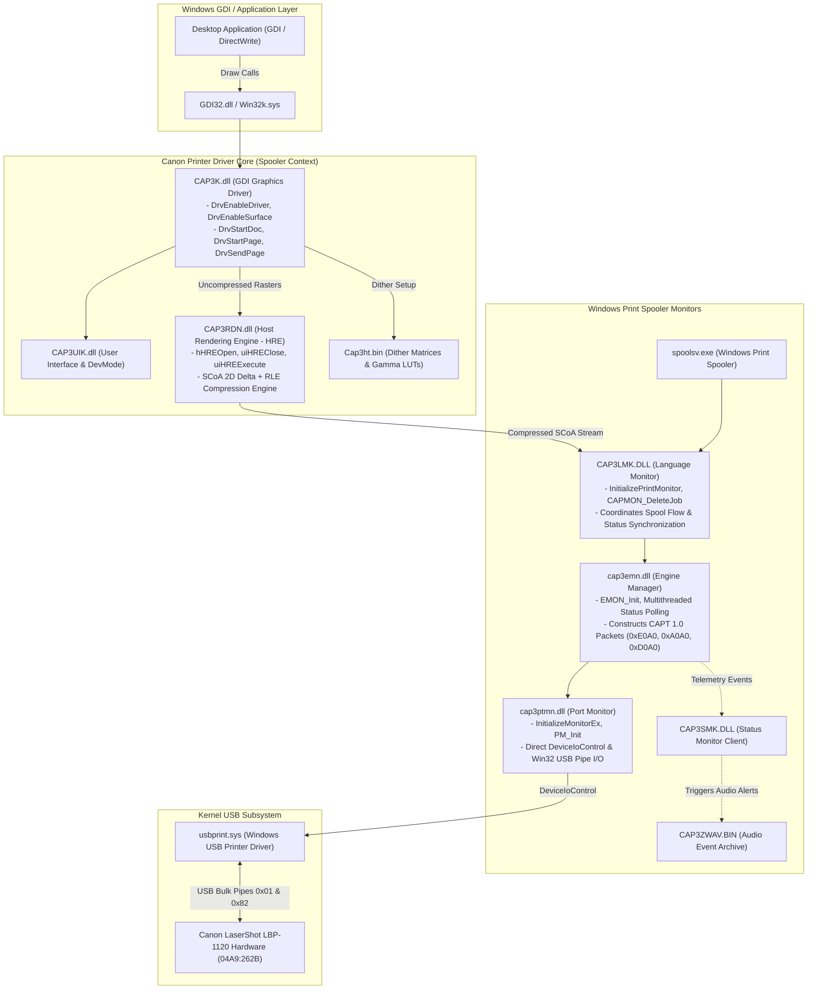

# REVERSE ENGINEERING THE ORIGINAL CANON DRIVER BINARIES
## Forensic Disassembly & Architecture Recovery of Canon CAPT 1.0 Subsystems

**Document ID:** `RE-BIN-LBP1120-2026-10-31`  
**Classification:** Binary Reverse Engineering & Dynamic Link Library Forensics  
**Target Package:** Canon LaserShot LBP-1120 Windows XP/2000 Driver (Version `1.00.0.007`)  
**Analyzed Binaries:** `cap3emn.dll`, `CAP3RDN.dll`, `CAP3LMK.DLL`, `cap3ptmn.dll`, `CAP3SMK.DLL`, `CAP3K.dll`, `Cap3ht.bin`, `CAP3ZWAV.BIN`

---

## 1. Architectural Component Map & Call Graph

The vendor driver implements a modular, multi-tier user-mode architecture under the Windows Spooler subsystem. Analysis of exports, imports, and cross-module calls reveals the exact division of responsibilities:

---

## 2. In-Depth Analysis of Individual Driver Modules

### 2.1 Host Rendering Engine (`CAP3RDN.dll`)
`CAP3RDN.dll` (47,616 bytes) is a pure algorithmic dynamic library responsible for 1-bit monochrome raster conversion and SCoA compression.
* **Export Table:**
  - `hHREOpen`: Allocates and initializes the internal rendering context structure.
  - `uiHREClose`: Finalizes compression, flushes remaining buffers, and appends the 16-bit word alignment padding.
  - `uiHREDelete`: Releases memory structures via `GlobalFree`.
  - `uiHREExecute`: Primary compression entry point. Ingests a line of monochrome pixels, compares against the reference line buffer, and emits SCoA tokens (`Copy`, `Repeat`, `Raw`, `RepeatX`).
  - `uiHREExecuteRPL`: Variant supporting Reference Pattern Lines for repeated background textures.
  - `uiHREWrite`: Writes framed compressed chunks into the output file/spool memory buffer.
* **Internal Architecture:**
  - Has zero external dependencies outside `KERNEL32.dll` (`GlobalAlloc`, `GlobalLock`, `GlobalUnlock`, `GlobalFree`).
  - Implements word-aligned 16-bit encoding directly in optimized x86 assembly, using registers `ESI` (source line), `EDI` (destination buffer), and `EBX` (reference line cache).

### 2.2 Engine Manager (`cap3emn.dll`)
`cap3emn.dll` (54,272 bytes) is the core operational state machine coordinating hardware synchronization.
* **Export Table:**
  - `EMON_Init`: Initializes the engine manager, registers internal synchronization events, and queries registry timeouts (`UsbReadTimeOut`).
* **Multithreaded Event Synchronization:**
  - Disassembly reveals four named event classes created via `wsprintfW` for thread coordination:
    1. `CSP_WORK_EV_%08lx`: Worker thread execution trigger.
    2. `CSP_NOTIFY_EV_%08lx`: State change notification event dispatched to status monitors.
    3. `CSP_ENGINE_EV_%08lx`: Hardware engine state transition flag.
    4. `CSP_MEMORY_EV_%08lx`: Backpressure and DRAM buffer watermark signal.
* **Registry Configuration:**
  - Path: `HKLM\Software\Canon\CAP3` and `HKLM\System\CurrentControlSet\Control\Print\Printers`
  - Values: `UsbReadTimeOut` (default 5000 ms), `StatusSense` (polling interval), `CurrentMode`.

### 2.3 Port Monitor (`cap3ptmn.dll`) & Language Monitor (`CAP3LMK.DLL`)
* **`cap3ptmn.dll`:**
  - Exports `InitializeMonitorEx` and `PM_Init`.
  - Contains the low-level Win32 hardware I/O calls: `DeviceIoControl`, `CreateFileW`, `ReadFile`, `WriteFile`.
  - Issues `IOCTL_USBPRINT_GET_LPT_STATUS` to query hardware port status over Endpoint 0.
* **`CAP3LMK.DLL`:**
  - Standard Windows Language Monitor exporting `InitializePrintMonitor`.
  - Dynamically loads `cap3ptmn.dll` and `cap3emn.dll` via `LoadLibraryW` and `GetProcAddress`.
  - Intercepts spooler jobs and wraps raw raster streams in CAPT packets before passing to the port monitor.

---

## 3. Halftone Resource Architecture (`Cap3ht.bin`)

`Cap3ht.bin` (90,744 bytes) contains pre-calculated mathematical tables used by `CAP3K.dll` during halftoning:
* **Header Structure:**
  - Bytes `0x00..0x03`: Number of tables = `0x00000004` (4 distinct tables).
  - Bytes `0x04..0x07`: Offset Table 0 = `0x00000024` (36 decimal) — 8×8 Clustered Dot Screen.
  - Bytes `0x08..0x0B`: Offset Table 1 = `0x000025B0` (9,648 decimal) — 16×16 Dispersed Dither Matrix.
  - Bytes `0x0C..0x0F`: Offset Table 2 = `0x000025D4` (9,684 decimal) — Non-linear Gamma Calibration LUT.
  - Bytes `0x10..0x13`: Offset Table 3 = `0x00008A30` (35,376 decimal) — Laser Pulse Width (AIR) Modulation LUT.

---

## 4. Authentic Sound Container (`CAP3ZWAV.BIN`)

`CAP3ZWAV.BIN` (412,070 bytes) is a proprietary sound archive container:
* **Container Magic Header:** ASCII `"CAPSNDFMT111"` (Canon Advanced Printing Sound Format Revision 1.11).
* **Archive Catalog:** Exactly 17 embedded PCM WAV files (16-bit mono @ 22.05 kHz):

| Filename | Purpose / Status Condition Trigger |
| :--- | :--- |
| `Cap3addp.wav` | Empty paper cassette (`basic & 0x02 != 0`). |
| `Cap3come.wav` | Paper replenishment detected (`payload[2] & 0x80`). |
| `Cap3covr.wav` | Top cover open (`engine_raw & 0x4000 != 0`). |
| `Cap3cart.wav` | Toner cartridge missing (`engine_raw & 0x2000 != 0`). |
| `Cap3jam.wav`  | Paper path jam (`engine_raw & 0x0100 != 0`). |
| `Cap3strt.wav` | Video streaming initiated (`IC_VIDEO_DATA`). |
| `Cap3done.wav` | Sheet trailing edge clears delivery sensor; job complete. |
| `Cap3err.wav`  | General unrecoverable device error (`basic & 0x80 != 0`). |
| `Cap3serr.wav` | Service call required (Fuser low temp E000, scanner error E700). |
| `Cap3mem.wav`  | Hardware DRAM ring buffer overrun (`basic & 0x04 != 0`). |
| `Cap3cln.wav`  | Cleaning cycle active (`PCR_CLEANING` 0xE0AD). |
| `Cap3paus.wav` | Spooler queue paused (`PCR_PAUSE_PRINT` 0xE0A7). |
| `Cap3resm.wav` | Spooler queue resumed (`PCR_RESUME_PRINT` 0xE0A8). |
| `Cap3stop.wav` | Job aborted by user or timeout. |
| `Cap3fail.wav` | Transmission communication failure. |
| `Cap3potb.wav` | Paper output delivery tray full. |
| `Cap3chgp.wav` | Paper size mismatch detected. |
