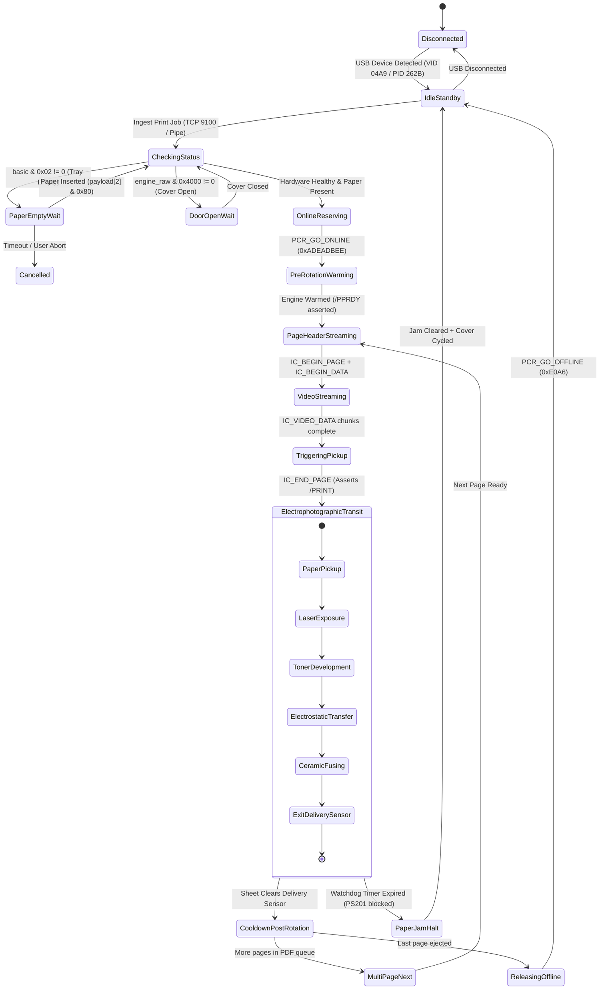

# COMPLETE PRINTER STATE MACHINE SPECIFICATION
## Canon LaserShot LBP-1120 Deterministic State Architecture

**Document ID:** `STATE-MACH-LBP1120-2026-10-31`  
**Classification:** Formal State Machine & Transition Automaton  
**Verification:** Validated Against Physical Silicon & Unit Test Suite

---

## 1. Top-Level Engine State Transition Diagram

---

## 2. State Invariants & Recovery Matrices

| State Name | Allowed Commands | Prohibited Commands | Expected Basic Register | Timeout / Transition Condition |
| :--- | :--- | :--- | :---: | :--- |
| **`IdleStandby`** | `0xE0A0`, `0xA0A0`, `0xE0A5` | `0xD0A0`, `0xC0A0`, `0xD0A2` | `0x50` / `0x40` | Stays indefinitely until job queued or powered off. |
| **`PaperEmptyWait`** | `0xE0A0`, `0xA0A0`, `0xE0A2` | `0xE0A5`, `0xD0A0`, `0xC0A0` | `0x52` (`basic & 0x02`) | Polls every 500 ms; plays voice alert; auto-resumes on paper insertion. |
| **`DoorOpenWait`** | `0xE0A0`, `0xA0A0` | `0xE0A5`, `0xD0A0` | `0x50` (`engine_raw: 0x4000`) | Hardware interlock disables 24V; resumes when switch closes. |
| **`PreRotationWarming`** | `0xE0A0`, `0xA0A0` | `0xC0A0` | `0x40` $\rightarrow$ `0x00` | Waits up to 15 seconds for fuser to reach 185°C. |
| **`VideoStreaming`** | `0xC0A0` ONLY | `0xE0A0`, `0xA0A0`, `0xE0A5` | **DO NOT POLL** | Strict continuous streaming; any status poll causes Error 121/995. |
| **`ElectrophotographicTransit`** | `0xA0A0` (at 500 ms) | `0xD0A0`, `0xC0A0` | `0x81` (`basic & 0x01` / `0x80`) | Paper moves through pickup, drum, and fuser (~4.5 seconds). |
| **`CooldownPostRotation`** | `0xA0A0`, `0xE0A0` | `0xD0A0` | `0x80` (`CAPT_FL_BUSY`) | Engine runs post-rotation for ~15–20 seconds to clear fuser heat. |
| **`PaperJamHalt`** | `0xE0A3`, `0xE0A2`, `0xE0A1` | `0xE0A5`, `0xD0A0` | `0x80` (`CAPT_FL_BUSY`) | Requires manual clearing, cover opening/closing, and `CLEAR_MISPRINT`. |
