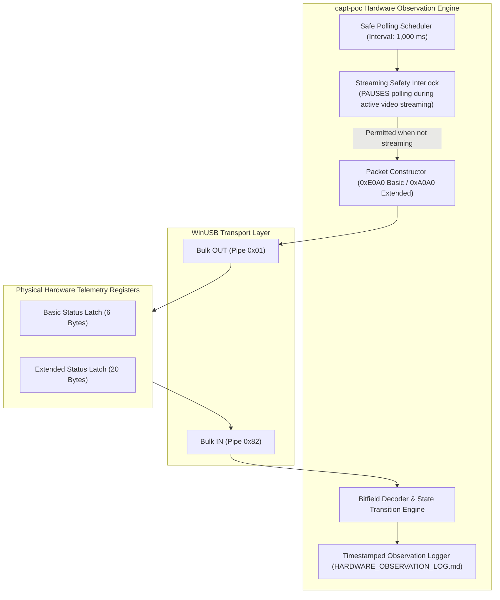

# PRINTER TELEMETRY ARCHITECTURE & SAFE HARDWARE OBSERVATION
## Non-Destructive Telemetry Harvesting & State Decoders

**Document ID:** `TELEM-ARCH-LBP1120-2026-10-31`  
**Classification:** Telemetry Architecture & Protocol Invariants  
**Target Hardware:** Canon LaserShot LBP-1120 (`USB\VID_04A9&PID_262B`)

---

## 1. Telemetry Harvesting Architecture

The software-based hardware observation system monitors the internal states of the Canon LaserShot LBP-1120 without requiring physical disassembly, multimeters, or oscilloscopes:



---

## 2. Safety Interlock & Prohibited Telemetry Phases

> [!CAUTION]
> **SAFETY INVARIANT:**  
> The observation system strictly enforces a **Streaming Safety Interlock**. Status queries (`0xE0A0` or `0xA0A0`) must **NEVER** be issued while the printer is in `VIDEO_INGRESS_MODE` (between `IC_BEGIN_DATA` 0xD0A1 and `IC_END_PAGE` 0xD0A2). 
> 
> Violating this rule injects a 4-byte command header into the ASIC's active SCoA decompression DMA channel, causing an unrecoverable endpoint stall (Win32 Error 121 / 995).

---

## 3. Register Bitfield Definitions & Decoding Schemas

### 3.1 Basic Status Reply (`0xE0A0`, 6 Bytes)
```text
Byte 0..1 : 0xA0, 0xE0 (Opcode 0xE0A0)
Byte 2..3 : 0x06, 0x00 (Total packet length: 6 bytes)
Byte 4    : basic register
Byte 5    : changed register (latched transitions since last query)
```

| Bit Position | Bit Mask | Flag Name | Meaning When Set (`1`) | Verified Real-World Trigger |
| :---: | :---: | :--- | :--- | :--- |
| **Bit 7** | `0x80` | `DEVICE_ERROR` / `BUSY` | Engine busy, fuser cooling, door open, or unready. | Set during 15s fuser cooldown or cover open. |
| **Bit 6** | `0x40` | `UNIT_FREE` | Printer is unreserved by any host session. | Set when idle standby; cleared during active print. |
| **Bit 4** | `0x10` | `OFFLINE` | Printer is offline / unready for raster streaming. | Set in standby; cleared by `PCR_GO_ONLINE`. |
| **Bit 2** | `0x04` | `BUFFER_FULL` | 512 KB DRAM ring FIFO watermark exceeded (>480 KB). | Backpressure active; host must pause video chunks. |
| **Bit 1** | `0x02` | `NO_PAPER` | Input paper cassette empty. | Actuated by optical feeler flag `PS202`. |
| **Bit 0** | `0x01` | `ENGINE_ACTIVE` | Main drive motor or polygon scanner active. | Set during pickup, laser scanning, and fusing. |

### 3.2 Extended Status Reply (`0xA0A0`, 20 Bytes)
```text
Byte 0..1  : 0xA0, 0xA0 (Opcode 0xA0A0)
Byte 2..3  : 0x14, 0x00 (Total packet length: 20 bytes)
Byte 4..5  : basic & changed registers
Byte 6     : aux register (0x04 = Solenoid active, 0x02 = Engine busy)
Byte 7     : controller flags
Byte 8     : paper_available_bits (0x80 = Paper in tray, 0x00 = Tray empty)
Byte 9     : reserved
Byte 10..11: engine_raw (16-bit LE)
             - 0x4000: Top cover / door open (SW301)
             - 0x2000: Toner cartridge missing / unseated
             - 0x0100: Paper path transport jam
Byte 12    : printed_pages (Cumulative hardware sheets completed)
Byte 13    : printing_pages (Sheets currently inside engine)
Byte 14    : shipped_pages (Sheets ejected to delivery tray)
Byte 15    : start_pages (Pickups initiated)
Byte 16..19: reserved padding
```

