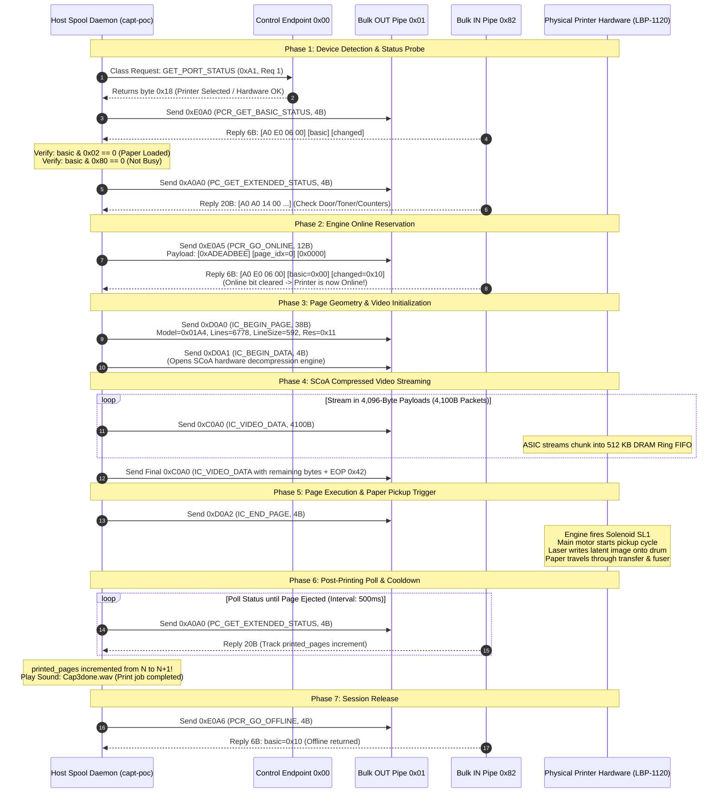

# PRINTING SEQUENCE DIAGRAM & PACKET FLOW
## Microsecond-Level USB Packet Flow & Hardware Handshakes

**Document ID:** `SEQ-DIAG-LBP1120-2026-10-31`  
**Classification:** Protocol Interaction Sequence Diagram  
**Scope:** Verified on Physical Canon LaserShot LBP-1120

---

## 1. High-Precision USB Packet Sequence

