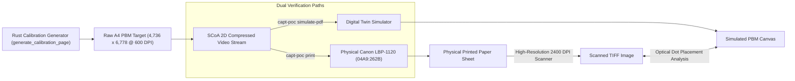

# PRINT CALIBRATION & OPTICAL BENCHMARK SUITE
## Physical Laser Output Correlation & Mechanical Calibration Target

**Document ID:** `CALIB-SUITE-LBP1120-2026-10-31`  
**Classification:** Print Quality Metrics & Optical Calibration Target  
**Resolution:** 600 $\times$ 600 DPI Native Laser (Canonical A4: $4,736 \times 6,778$ pixels)

---

## 1. Calibration Architecture & Purpose

The Print Calibration Suite provides standardized, mathematically defined test targets to correlate software raster models against physical electrophotographic laser output on the Canon LaserShot LBP-1120.



---

## 2. Integrated Calibration Benchmark Targets

The calibration page integrates six critical diagnostic zones across the canonical A4 canvas:

### 2.1 Zone 1: Geometric Alignment & Margin Verification
- **Corner Crosshairs:** Placed at exact pixel coordinates `[112, 120]`, `[4624, 120]`, `[112, 6658]`, and `[4624, 6658]`.
- **Measurement Purpose:** Measures pickup roller skew and validates that `margin_left` (112 dot clocks $\approx 4.74\text{ mm}$) and `margin_top` (120 scanlines $\approx 5.08\text{ mm}$) match physical paper edges.
- **Metric Coordinate Grid:** 10 mm tick marks along horizontal and vertical borders to measure paper shrink during transit through the $185^\circ\text{C}$ SURF ceramic fuser.

### 2.2 Zone 2: Micro-Typography Legibility Scale
- Text rendered using the embedded 8×8 bitfont at integer scale multipliers:
  - **Scale 1 (8 Pixels High $\approx 1.0\text{ pt}$):** Tests laser spot sharpness and toner particle agglomeration.
  - **Scale 2 (16 Pixels High $\approx 2.0\text{ pt}$):** Tests fine serif definition.
  - **Scale 4 (32 Pixels High $\approx 4.0\text{ pt}$):** Minimum legal disclaimer standard.
  - **Scale 8 (64 Pixels High $\approx 8.0\text{ pt}$):** Body typography contrast.

### 2.3 Zone 3: 1-Dot Line Resolution & Modulation Transfer Function (MTF)
- **1-Pixel Line Pairs:** Isolated single-pixel black lines separated by single-pixel white lines ($42.33\ \mu\text{m}$ pitch):
  - **Vertical Lines:** Tests horizontal laser diode switching rise/fall time ($\approx 26.4\text{ ns}$ dot clock).
  - **Horizontal Lines:** Tests vertical scanner mirror facet-to-facet pitch accuracy.
  - **Diagonal $45^\circ$ Lines:** Tests Automatic Image Refinement (AIR) edge anti-aliasing logic.

### 2.4 Zone 4: 16-Step Grayscale Density Wedge
- 16 discrete patches progressing from 0% (solid white) to 100% (solid black) in 6.25% increments:
  - Compares 8×8 Clustered Dot screening (Normal mode) against Serpentine Floyd-Steinberg (Photo mode).
  - Measures optical spot gain (dot broadening due to magnetic toner particle attraction).

### 2.5 Zone 5: Concentric Circles (Gear Eccentricity & Drum Runout)
- Concentric circular rings with radii from 50 pixels to 600 pixels.
- **Measurement Purpose:** Any mechanical eccentricity in the main drive motor gear train, OPC drum shaft, or transfer roller appears as an elliptical distortion (aspect ratio deviation from 1.000).

### 2.6 Zone 6: Solid Black Field & Uniform Halftone (HV Uniformity)
- $50\text{ mm} \times 20\text{ mm}$ solid black block and 50% checkerboard tint block.
- **Measurement Purpose:** Detects Primary Charge Roller contamination, magnetic developing cylinder bias defects, or transfer sponge wear.

---

## 3. Physical Scan vs. Simulation Correlation Protocol

To ensure empirical accuracy without premature optical claims:
1. Print the calibration target to the physical printer using:
   ```powershell
   cargo run -- generate-calibration calibration.pbm
   cargo run -- print calibration.pbm
   ```
2. Scan the printed sheet on a calibrated flatbed scanner at $\ge 1200\text{ DPI}$ (grayscale TIFF, uncompressed).
3. Compute the Optical Spot Gain Ratio ($S_{\text{gain}}$):
   $$S_{\text{gain}} = \frac{\text{Measured Optical Black Area}}{\text{Theoretical Digital Pixel Area}}$$
4. Record results in `HARDWARE_OBSERVATION_LOG.md` before claiming optical equivalence.

