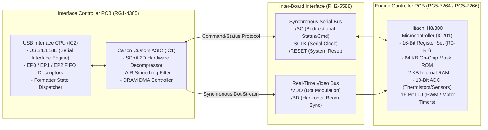

# PROCESSOR & SILICON ARCHITECTURE SPECIFICATION
## Canon LaserShot LBP-1120 Embedded Microcontroller Systems

**Document ID:** `PROC-ARCH-LBP1120-2026-10-31`  
**Classification:** Embedded Microcontroller & Silicon Reverse Engineering  
**Target Processors:** Hitachi H8/300 Series (Engine MCU) & USB Controller Core

---

## 1. Executive Silicon Overview

The Canon LaserShot LBP-1120 employs a distributed embedded processing model. High-level host communication and raster video synchronization are handled by the Interface Controller (Formatter), while physical real-time electrophotographic engine management is governed by an 8/16-bit microcontroller on the Engine Controller (DC Controller).

Neither processor runs Linux, Windows CE, or a general-purpose operating system. Both run **deterministic, bare-metal microcode** executing cyclic executives synchronized to hardware timers and external sensor interrupts.



---

## 2. Engine Microcontroller: Hitachi H8/300 Family (`HD6433292` / `HD6473294`)

### 2.1 Silicon Identity & Specifications
- **Architecture:** Hitachi (now Renesas) H8/300 8/16-Bit CISC Microcontroller.
- **Part Designation:** `HD6433292` (Mask ROM version) / `HD6473294` (PROM / One-Time Programmable version).
- **Package:** 80-Pin Plastic Quad Flat Package (QFP-80).
- **Core Operating Frequency:** 16.0 MHz (Internal bus cycle $\phi = 62.5\text{ ns}$).
- **Supply Voltage:** +3.3V DC / +5.0V DC tolerant I/O.
- **Memory Subsystem:**
  - **Internal ROM:** 64 KB (Addresses `0x0000` to `0xFFFF` in normal memory mode).
  - **Internal RAM:** 2 KB (Fast zero-wait-state scratchpad & stack, mapped at `0xFB80` to `0xFF7F`).

### 2.2 Register Model & Instruction Set
The H8/300 core provides sixteen 8-bit general registers (`R0H..R7H` and `R0L..R7L`), which can also be paired and manipulated as eight 16-bit registers (`R0` through `R7`):

| Register | Name / Primary Function | Bit Width |
| :--- | :--- | :--- |
| `R0` / `R0H:R0L` | General Purpose / Primary Accumulator | 16-Bit (2 × 8-bit) |
| `R1` / `R1H:R1L` | General Purpose / Math Operand | 16-Bit (2 × 8-bit) |
| `R2` / `R2H:R2L` | General Purpose / Data Pointer | 16-Bit (2 × 8-bit) |
| `R3` / `R3H:R3L` | General Purpose / Sensor State Flags | 16-Bit (2 × 8-bit) |
| `R4` / `R4H:R4L` | General Purpose / Fuser Target Setpoint | 16-Bit (2 × 8-bit) |
| `R5` / `R5H:R5L` | General Purpose / Paper Feed Millisecond Counter | 16-Bit (2 × 8-bit) |
| `R6` / `R6H:R6L` | General Purpose / Frame Index | 16-Bit (2 × 8-bit) |
| `R7` / `SP` | Hardware Stack Pointer | 16-Bit |
| `PC` | Program Counter | 16-Bit (`0x0000..0xFFFF`) |
| `CCR` | Condition Code Register (`I, U, H, U, N, Z, V, C`) | 8-Bit (`I` = Global Interrupt Mask) |

**Instruction Set Characteristics:**
- 57 fundamental instructions (compact 2-byte and 4-byte encodings).
- Dedicated 8-bit and 16-bit add/subtract/multiply (`MULXU`) and divide (`DIVXU`).
- High-efficiency bit manipulation instructions (`BSET`, `BCLR`, `BNOT`, `BTST`, `BAND`, `BIAND`, `BOR`, `BIOR`, `BXOR`, `BIXOR`) operating directly on memory-mapped I/O registers in a single cycle.

### 2.3 Integrated Peripheral Architecture

```text
Hitachi H8/300 Peripheral Bus
├── 16-Bit Integrated Timer Unit (ITU)
│   ├── Channel 0: Polygon Scanner Motor PWM Speed Control
│   ├── Channel 1: Main Motor Stepping Frequency Generator
│   └── Channel 2: Laser Exposure Line Interval Timer
├── 8-Bit Timer Unit (TMR)
│   ├── Timer 0: Paper Pick-up Solenoid (SL1) Pulse Timer (~50 ms)
│   └── Timer 1: Paper Jam Watchdog Interval Timer
├── Analog-to-Digital Converter (10-Bit ADC)
│   ├── AN0: Main Fixing Thermistor (TH1) Analog Feedback
│   ├── AN1: Sub-Thermistor (TH2) Analog Feedback
│   └── AN2: High-Voltage Current Sensing Feedback
├── Serial Communication Interface (SCI)
│   └── Channel 0: Synchronous serial transceiver interfacing /SC and SCLK
└── Programmable I/O Ports (Ports 1 - 9, A, B)
    ├── Port 1: Sensor Inputs (PS201 Delivery, PS202 Tray, SW301 Interlock)
    ├── Port 2: Laser Modulation Gate & Safety Interlock Monitor
    ├── Port 3: Solenoid & Motor Phase Driver Outputs
    └── Port 4: High-Voltage Control PWM Lines (Charge, Dev, Transfer)
```

---

## 3. Interrupt Vector Architecture

The H8/300 vector table occupies addresses `0x0000` through `0x003F` in non-volatile ROM:

| Vector Number | Address Range | Trigger Source | Routine Function in Engine Microcode |
| :--- | :--- | :--- | :--- |
| **0** | `0x0000 - 0x0001` | Power-On / System Reset | Reset entry point: Initializes I/O ports, zeroes RAM, sets up stack pointer at `0xFF7E`. |
| **1** | `0x0002 - 0x0003` | Reserved | Factory diagnostic vector. |
| **2** | `0x0004 - 0x0005` | Reserved | Internal test. |
| **3** | `0x0006 - 0x0007` | NMI (Non-Maskable Interrupt) | Emergency shutdown: Triggered by Top Cover open (`SW301`) or fuser over-temperature detection. |
| **4** | `0x0008 - 0x0009` | IRQ0 | Beam Detect (`/BD`) sync pulse: Starts horizontal laser line timing counter. |
| **5** | `0x000A - 0x000B` | IRQ1 | Serial Command line (`/SC`) falling edge: Wakes up serial command decoder. |
| **6** | `0x000C - 0x000D` | IRQ2 | Paper sensor transition interrupt (PS201 / PS202 state change). |
| **8..11** | `0x0010 - 0x0017` | ITU0..ITU2 Compare Match | High-resolution motor speed regulation and fuser triac gate trigger timing. |
| **19** | `0x0026 - 0x0027` | ADC End of Conversion | Fuser temperature PID calculation loop (~10 ms interval). |

---

## 4. Interface Controller USB Processor (IC2)

### 4.1 Functional Role
The Interface Controller USB processor operates as an autonomous protocol bridge between the Universal Serial Bus and the Canon Formatter ASIC (IC1):

- **USB 1.1 Full Speed Transceiver:** Direct connection to D+ and D- with internal 1.5 k$\Omega$ pull-up resistor on D+ to signal Full Speed (12 Mbps) presence.
- **Endpoint Buffering:**
  - **Endpoint 0 (Control):** Bi-directional 64-byte FIFO for USB standard enumeration and IEEE 1284 class requests (`GET_DEVICE_ID`, `GET_PORT_STATUS`).
  - **Endpoint 1 (Bulk OUT):** 64-byte hardware FIFO connected via high-speed DMA channel to the 512 KB onboard DRAM buffer.
  - **Endpoint 2 (Bulk IN):** 64-byte hardware FIFO for transmitting Basic Status (6 bytes) and Extended Status (20 bytes) back to the host spooler.

### 4.2 Firmware Execution Paradigm
The USB processor executes a **tight event loop** monitoring the USB Serial Interface Engine (SIE) interrupt flags:
1. When a packet arrives on Bulk OUT (0x01), the hardware asserts an RX interrupt.
2. The packet header is decoded (first 4 bytes: `opcode` + `total_size`).
3. If the opcode is a control command (`0xE0xx` or `0xA0xx`), it routes the request directly to the serial command interface (`/SC`) to the engine MCU or reads the internal status latch, queuing the response onto Bulk IN (0x82).
4. If the opcode is `0xC0A0` (`IC_VIDEO_DATA`), the payload is streamed directly into the DRAM ring FIFO without intermediate CPU re-copying, enabling throughput exceeding 8 Mbps.
