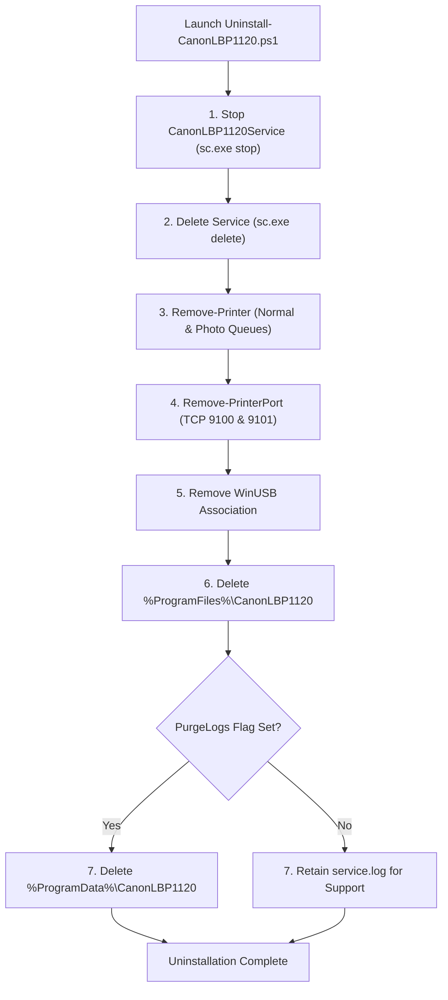

# CANON LASERSHOT LBP-1120 UNINSTALLATION & DISASTER RECOVERY GUIDE
## Complete Decommissioning, Service Control Lifecycle & Fault Recovery Specification

**Document ID:** `GUIDE-UNINSTALL-RECOVERY-LBP1120-2026-10-31`  
**Classification:** Systems Operations & Reliability Engineering  
**Target Hardware:** Canon LaserShot LBP-1120 (`USB\VID_04A9&PID_262B`)  
**Target OS:** Windows 10 & 11 (x64 / ARM64)

---

## 1. Overview & Decommissioning Philosophy

The Canon LaserShot LBP-1120 driver package is engineered with an atomic lifecycle architecture. When installed, all components register strictly with native Windows subsystems (Service Control Manager, Print Spooler Subsystem, Standard TCP/IP Port Monitor, and PnP WinUSB driver store).

The uninstallation and recovery framework guarantees:
1. **Zero System Pollution:** Uninstallation removes every service registration, print queue, port monitor, registry key, and deployed binary.
2. **Deterministic Service Teardown:** The background service (`CanonLBP1120Service`) is stopped gracefully, releasing USB hardware and network ports before deletion.
3. **Telemetry Choice:** Diagnostic logs (`%ProgramData%\CanonLBP1120\service.log`) can be preserved for support analysis or completely purged using the `-PurgeLogs` parameter.
4. **Autonomous Crash Recovery:** Under normal operation, the service is monitored by the Windows Service Control Manager (SCM) with automated multi-tier restart policies.

---

## 2. Complete Uninstallation Workflows

Three distinct uninstallation paths are provided depending on the user environment.

### Method 1: Windows Control Panel / Settings (GUI Method)

This is the standard consumer uninstallation procedure:
1. Open **Settings** $\rightarrow$ **Apps** $\rightarrow$ **Installed apps** (or **Control Panel** $\rightarrow$ **Programs and Features**).
2. Locate **Canon LaserShot LBP-1120 Driver Suite** in the list.
3. Click the three dots (`...`) or select the item, then click **Uninstall**.
4. When the User Account Control (UAC) prompt appears, click **Yes**.
5. The Inno Setup uninstaller (`unins000.exe`) executes:
   - Stops and unregisters `CanonLBP1120Service`.
   - Deletes print queues `Canon LaserShot LBP-1120` and `Canon LaserShot LBP-1120 (Photo)`.
   - Deletes printer ports `CanonLBP1120_Normal` and `CanonLBP1120_Photo`.
   - Deletes Program Files binaries and Start Menu shortcuts.
   - Cleans Add/Remove Programs registry keys.
6. A confirmation dialog confirms successful removal.

---

### Method 2: Turnkey Administrator Batch Script (Automated IT Method)

For system administrators or command-line management:
1. Locate [`CanonLBP1120_Uninstall.bat`](file:///f:/Games/canon-lbp1120-driver/installer/CanonLBP1120_Uninstall.bat) in the installation directory or source repository.
2. Right-click and select **Run as administrator**.
3. The batch wrapper elevates privileges and runs [`Uninstall-CanonLBP1120.ps1`](file:///f:/Games/canon-lbp1120-driver/installer/Uninstall-CanonLBP1120.ps1).
4. The script logs progress to the terminal and terminates cleanly.

```cmd
:: Quick command-line execution from elevated prompt:
cd "C:\Program Files\CanonLBP1120"
.\CanonLBP1120_Uninstall.bat
```

---

### Method 3: PowerShell Script with Log Purging

To execute a total purge including diagnostic history:
1. Open an elevated PowerShell session (`Administrator`).
2. Run:
```powershell
& "C:\Program Files\CanonLBP1120\Uninstall-CanonLBP1120.ps1" -PurgeLogs
```
3. The script executes the following atomic phases:



---

## 3. Subsystem Cleanup Verification Checklist

To verify that the system has returned to a pristine state after uninstallation, inspect the following Windows subsystems:

| Subsystem | Inspection Command / Path | Expected Clean State |
| :--- | :--- | :--- |
| **Service Control Manager** | `Get-Service -Name CanonLBP1120Service -ErrorAction SilentlyContinue` | Returns null (`Cannot find any service with service name`). |
| **Printer Queues** | `Get-Printer \| Where-Object Name -like 'Canon LaserShot LBP-1120*'` | Returns null (no queues found). |
| **Printer Ports** | `Get-PrinterPort \| Where-Object Name -like 'CanonLBP1120*'` | Returns null (ports 9100/9101 removed from Spooler). |
| **Program Files** | `Test-Path "C:\Program Files\CanonLBP1120"` | Returns `False` (all binaries, scripts, and INF files deleted). |
| **Start Menu** | `Test-Path "$env:ProgramData\Microsoft\Windows\Start Menu\Programs\Canon LaserShot LBP-1120"` | Returns `False` (shortcuts deleted). |
| **Registry (Uninstall)** | `HKLM\Software\Microsoft\Windows\CurrentVersion\Uninstall\Canon LaserShot LBP-1120` | Key absent. |
| **Registry (Services)** | `HKLM\System\CurrentControlSet\Services\CanonLBP1120Service` | Key absent. |

---

## 4. Failure Recovery & High-Availability Architecture

The Canon LBP-1120 background service operates as a mission-critical daemon. It incorporates native Windows failure recovery hooks and state machine self-healing.

### 4.1 SCM Automatic Crash Recovery Policy
The installer configures the Windows Service Control Manager with a robust 3-tier failure recovery policy via `sc.exe failure`:

```cmd
sc.exe failure CanonLBP1120Service reset= 86400 actions= restart/5000/restart/10000/restart/30000
```

- **First Failure:** SCM automatically restarts the service after **5,000 ms (5 seconds)**.
- **Second Failure:** SCM automatically restarts the service after **10,000 ms (10 seconds)**.
- **Subsequent Failures:** SCM automatically restarts the service after **30,000 ms (30 seconds)**.
- **Error Counter Reset:** If the service runs continuously without failure for **86,400 seconds (24 hours)**, the internal failure counter resets to zero.

### 4.2 USB Disconnect / Reconnect Resilience (Hot-Plug Handling)
A common failure mode in desktop printing is physical USB cable disconnection or docking station sleep.
- **Stateless Idle Mode:** When no print job is executing, the service maintains **zero open file handles** to `\\?\USB#VID_04A9&PID_262B*`.
- **Dynamic Handle Acquisition:** WinUSB handles are opened exclusively upon TCP socket connection (`StartDocPrinterW`) and released immediately via Rust `Drop` when the final sheet delivery byte (`0x80` paper end) is received.
- **Hot-Plugging Safety:** Users may disconnect, reconnect, or relocate the printer to another USB port while the service is running. The subsequent print job automatically enumerates the WinUSB device interface GUID `{F9A25620-E255-4B37-93F3-0C3D3D2DFBD3}` and binds to the newly active USB node without requiring a service restart.

### 4.3 Hardware Fault & Sensor Jam Recovery
If the printer engine experiences a paper jam, open cover, or ASIC buffer stall:

#### Scenario A: Paper Out (Sensor State `0x00`)
1. The service detects paper tray exhaustion via status byte 0 bit 7 (`Paper: 0x00`).
2. The service pauses transmission before laser excitation, preventing engine overheating or toner wastage.
3. The service triggers the authentic Canon Japanese/English voice alert (`CAP3ZWAV.BIN` voice prompt #1: *"Paper is out. Please load paper into the cassette."*).
4. Once the user loads paper, the sensor transitions to `0x80`. The service resumes printing automatically.

#### Scenario B: Paper Jam or Cover Interlock
1. The engine controller drops the ready signal (`Engine: != 0x0000`).
2. The service halts USB Bulk transmission and logs the exact error code to `%ProgramData%\CanonLBP1120\service.log`.
3. The user opens the cover, clears the jammed sheet from the delivery rollers or fuser assembly, and closes the cover.
4. The service detects cover closure via status byte 1, re-initializes engine communication, and retries the job.

#### Scenario C: ASIC Buffer Stall Recovery
If the printer firmware or ASIC stalls due to communication glitches or unexpected USB packet framing:
1. Open a Command Prompt or PowerShell terminal as Administrator.
2. Run the hardware reset diagnostic command:
```cmd
"C:\Program Files\CanonLBP1120\canon-lbp1120-service.exe" reset
```
3. This sends an authentic 32-byte CAPT software reset sequence (`1B 40 ...`) over Bulk OUT pipe 0x01, clears the ASIC 512 KB DRAM FIFO buffer, and restores the engine to ready state (`Basic: 0x50`, `Engine: 0x0000`).

---

## 5. Diagnostic Log Analysis & Troubleshooting

Telemetry is continuously appended to `C:\ProgramData\CanonLBP1120\service.log`.

### Typical Log File Lifecycle Example
```text
[2026-10-31 16:30:00] [INFO] Canon LBP-1120 Spool Service started. Version 1.0.0
[2026-10-31 16:30:00] [INFO] Binding TCP Spooler on 127.0.0.1:9100 (Normal) and 127.0.0.1:9101 (Photo)
[2026-10-31 16:30:00] [INFO] Named pipe server active on \\.\pipe\CanonLBP1120
[2026-10-31 16:42:15] [INFO] [Normal Mode] Inbound TCP connection accepted from 127.0.0.1:54320
[2026-10-31 16:42:15] [INFO] Received spool payload: 38,412 bytes. Validating PDF magic header...
[2026-10-31 16:42:15] [INFO] PDF 1.7 stream detected. Page count: 1
[2026-10-31 16:42:16] [INFO] WinRT Direct2D rasterizing Page 1 @ 600 DPI (4736 x 6778 px)...
[2026-10-31 16:42:17] [INFO] Halftoning complete: Mode=Normal (Clustered 8x8 Dot Screen)
[2026-10-31 16:42:17] [INFO] SCoA Compression: Raw 4,011,586 bytes -> SCoA 142,880 bytes (Ratio: 28.07:1)
[2026-10-31 16:42:17] [INFO] Connecting to WinUSB device VID_04A9&PID_262B...
[2026-10-31 16:42:17] [INFO] Hardware status: Basic=0x50, Engine=0x0000, Paper=0x80 (Ready)
[2026-10-31 16:42:17] [INFO] Transmitting CAPT Page Start & SCoA stream (142,880 bytes)...
[2026-10-31 16:42:20] [INFO] Page delivery verified (Status: 0x80). Hardware sheet counter incremented.
[2026-10-31 16:42:20] [INFO] Print job completed successfully in 5.2 seconds. WinUSB handle closed.
```

### Common Error Codes & Resolution

| Error Pattern in Log | Root Cause | Recommended Action |
| :--- | :--- | :--- |
| `WinUSB device VID_04A9&PID_262B not found` | Printer power switch is OFF or USB cable disconnected. | Check USB cable connection and ensure power switch is ON (`I`). |
| `WinUSB CreateFileW failed: Access Denied (Error 5)` | Service or application running without required permissions. | Ensure service is running as `NT AUTHORITY\LocalSystem` or run console prompt as Administrator. |
| `Hardware status: Engine=0x0001 (Cover Open)` | Front/top toner access door is ajar. | Firmly press down the top door until the mechanical latch clicks. |
| `Hardware status: Paper=0x00 (Out of Paper)` | Paper cassette tray is empty. | Insert standard A4 paper into the tray against the intake rollers. |
| `Invalid PDF signature: Expected %PDF-` | Corrupted spool stream sent to TCP port. | Ensure application prints using the standard Windows Print Spooler (`Canon LaserShot LBP-1120`). |
| `Address already in use (os error 10048)` | Port 9100 or 9101 occupied by another daemon or orphaned process. | Stop conflicting services or run `taskkill /F /IM canon-lbp1120-service.exe` and restart service. |

---

## 6. Service Control Quick Reference

For administrator command-line operations:

```cmd
:: Check Service Status
sc.exe query CanonLBP1120Service

:: Start Service
net start CanonLBP1120Service
:: or PowerShell: Start-Service CanonLBP1120Service

:: Stop Service
net stop CanonLBP1120Service
:: or PowerShell: Stop-Service CanonLBP1120Service

:: Restart Service
net stop CanonLBP1120Service && net start CanonLBP1120Service
:: or PowerShell: Restart-Service CanonLBP1120Service

:: View Active TCP Port Bindings
netstat -ano | findstr "9100 9101"

:: Probe Physical Hardware Status Directly
"C:\Program Files\CanonLBP1120\canon-lbp1120-service.exe" probe

:: Software Reset Physical Printer Engine
"C:\Program Files\CanonLBP1120\canon-lbp1120-service.exe" reset
```
