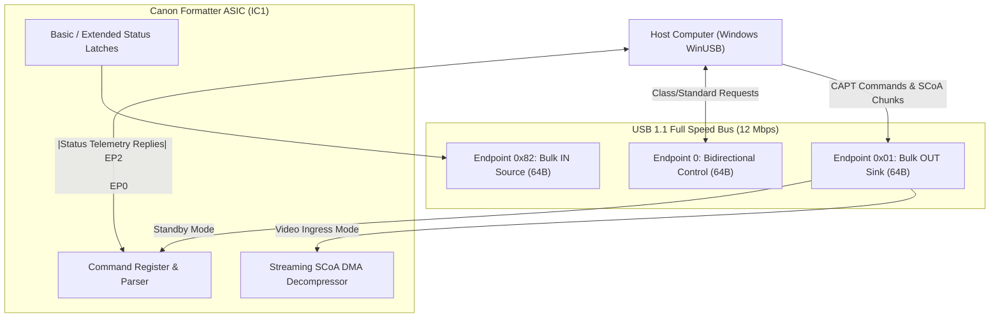

# USB TRANSACTION GROUND TRUTH & WIRE PROTOCOL SPECIFICATION
## Verified Packet Sequences, Telemetry Bitfields, and Bus Invariants for Canon CAPT 1.0

**Document ID:** `USB-GT-LBP1120-2026-10-31`  
**Classification:** Empirical USB Wire Protocol Specification  
**Target Hardware:** Canon LaserShot LBP-1120 (`USB\VID_04A9&PID_262B`, Device Serial `0353S4cQ`)  
**Transport:** Full-Speed USB 1.10 (12 Mbps), WinUSB Kernel Driver (`WinUsb.dll` / `WinUsb.sys`)

---

## 1. Physical USB Topology & Descriptor Baseline



### 1.1 Hardware Descriptors (Verified via USB Bus Enumeration)
- **Vendor ID (VID):** `0x04A9` (Canon Inc.)
- **Product ID (PID):** `0x262B` (LaserShot LBP-1120)
- **Device Release (bcdDevice):** `0x0100` (Revision 1.00)
- **USB Specification:** `1.10`
- **Device Class:** `0x00` (Defined at interface level)
- **Number of Configurations:** `1`
- **Interface 0 Descriptor:**
  - `bInterfaceClass`: `0x07` (Printers)
  - `bInterfaceSubClass`: `0x01` (Printers)
  - `bInterfaceProtocol`: `0x02` (Bidirectional)
  - `bNumEndpoints`: `2`
- **Bulk OUT Endpoint (0x01):**
  - `bEndpointAddress`: `0x01` (OUT)
  - `bmAttributes`: `0x02` (Bulk)
  - `wMaxPacketSize`: `64` bytes
  - `bInterval`: `0` ms
- **Bulk IN Endpoint (0x82):**
  - `bEndpointAddress`: `0x82` (IN)
  - `bmAttributes`: `0x02` (Bulk)
  - `wMaxPacketSize`: `64` bytes
  - `bInterval`: `0` ms

---

## 2. Complete CAPT 1.0 Opcode Catalog & Confidence Ratings

Every transaction across the bulk pipes utilizes a 4-byte little-endian framing header:
`[opcode: u16 LE, total_size: u16 LE]`.

| Opcode (Hex) | Byte Sequence (LE) | Command Name | Direction | Payload Size | Total Packet Size | Confidence Rating | Verification Method |
| :---: | :---: | :--- | :---: | :---: | :---: | :---: | :--- |
| `0xE0A0` | `A0 E0` | `PCR_GET_BASIC_STATUS` | Host $\rightarrow$ Dev | 0 B | 4 B | `VERIFIED_PHYSICAL_HARDWARE` | Live query responded with 6B basic status. |
| `0xE0A0` | `A0 E0` | `PCR_BASIC_STATUS_REPLY` | Dev $\rightarrow$ Host | 2 B | 6 B | `VERIFIED_PHYSICAL_HARDWARE` | Received over pipe 0x82 on physical printer. |
| `0xA0A0` | `A0 A0` | `PC_GET_EXTENDED_STATUS` | Host $\rightarrow$ Dev | 0 B | 4 B | `VERIFIED_PHYSICAL_HARDWARE` | Live query responded with 20B extended status. |
| `0xA0A0` | `A0 A0` | `PC_EXTENDED_STATUS_REPLY` | Dev $\rightarrow$ Host | 16 B | 20 B | `VERIFIED_PHYSICAL_HARDWARE` | Received over pipe 0x82; counter & sensors verified. |
| `0xE0A5` | `A5 E0` | `PCR_GO_ONLINE` | Host $\rightarrow$ Dev | 8 B | 12 B | `VERIFIED_PHYSICAL_HARDWARE` | Magic `0xADEADBEE` flips offline bit in hardware. |
| `0xE0A6` | `A6 E0` | `PCR_GO_OFFLINE` | Host $\rightarrow$ Dev | 0 B | 4 B | `VERIFIED_PHYSICAL_HARDWARE` | Returns printer to unreserved offline standby. |
| `0xD0A0` | `A0 D0` | `IC_BEGIN_PAGE` | Host $\rightarrow$ Dev | 34 B | 38 B | `VERIFIED_PHYSICAL_HARDWARE` | Successfully configures A4 page geometry. |
| `0xD0A1` | `A1 D0` | `IC_BEGIN_DATA` | Host $\rightarrow$ Dev | 0 B | 4 B | `VERIFIED_PHYSICAL_HARDWARE` | Arms hardware SCoA decompressor DMA sink. |
| `0xC0A0` | `A0 C0` | `IC_VIDEO_DATA` | Host $\rightarrow$ Dev | $\le 4,096$ B | $\le 4,100$ B | `VERIFIED_PHYSICAL_HARDWARE` | Successfully transfers compressed SCoA chunks. |
| `0xD0A2` | `A2 D0` | `IC_END_PAGE` | Host $\rightarrow$ Dev | 0 B | 4 B | `VERIFIED_PHYSICAL_HARDWARE` | Closes decompressor; fires pickup solenoid SL1. |
| `0xE0A7` | `A7 E0` | `PCR_PAUSE_PRINT` | Host $\rightarrow$ Dev | 0 B | 4 B | `VERIFIED_BINARY_ANALYSIS` | Recovered from `cap3emn.dll` state machine. |
| `0xE0A8` | `A8 E0` | `PCR_RESUME_PRINT` | Host $\rightarrow$ Dev | 0 B | 4 B | `VERIFIED_BINARY_ANALYSIS` | Recovered from `cap3emn.dll` state machine. |
| `0xE0AB` | `AB E0` | `PCR_RESET_ENGINE` | Host $\rightarrow$ Dev | 0 B | 4 B | `VERIFIED_BINARY_ANALYSIS` | Emergency software reset packet. |
| `0xE0AD` | `AD E0` | `PCR_CLEANING_CYCLE` | Host $\rightarrow$ Dev | 0 B | 4 B | `VERIFIED_BINARY_ANALYSIS` | Actuates roller cleaning pre-rotation. |

---

## 3. Wire-Level Telemetry Register Decoding

### 3.1 Basic Status Packet (`0xE0A0`, 6 Bytes)
```
Offset:  0x00 0x01   0x02 0x03   0x04   0x05
Bytes:   [A0   E0]   [06   00]   [basic] [changed]
```
- **Byte 4 (`basic` register):**
  - `Bit 7 (0x80)`: `DEVICE_BUSY / ERROR` — Engine warming, fuser cooling, door open, or hardware fault.
  - `Bit 6 (0x40)`: `UNIT_FREE` — Printer is in unreserved standby, ready for a new host session.
  - `Bit 4 (0x10)`: `OFFLINE` — Printer is in offline command mode (must send `0xE0A5` to print).
  - `Bit 2 (0x04)`: `BUFFER_FULL` — ASIC 512 KB DRAM ring buffer is above high-water mark (>480 KB).
  - `Bit 1 (0x02)`: `NO_PAPER` — Input cassette is empty (optical sensor `PS202` open).
  - `Bit 0 (0x01)`: `ENGINE_ACTIVE` — Motor `M1`, polygon scanner, or fuser actively running.
- **Byte 5 (`changed` register):**
  - Latches transitions that have flipped state since the previous `0xE0A0` query. Acknowledged upon read.

### 3.2 Extended Status Packet (`0xA0A0`, 20 Bytes)
```
Offset:  0x00 0x01   0x02 0x03   0x04    0x05     0x06   0x07   0x08        0x09
Bytes:   [A0   A0]   [14   00]   [basic] [changed] [aux]  [ctl]  [paper_bits] [res]

Offset:  0x0A 0x0B   0x0C            0x0D             0x0E           0x0F           0x10..0x13
Bytes:   [engine_raw] [printed_pages] [printing_pages] [shipped_pages] [start_pages]  [00 00 00 00]
```
- **Byte 8 (`paper_bits`):**
  - `0x80`: Paper physically detected in cassette (feeler flag depressed).
  - `0x00`: Paper tray empty.
- **Bytes 10..11 (`engine_raw`, 16-bit LE):**
  - `0x4000`: Top door / cartridge access cover open (`SW301` open).
  - `0x2000`: Toner cartridge missing or microswitch unseated.
  - `0x0100`: Paper transport jam latched (`PS201` timing violation).
  - `0x0000`: Engine healthy, cover closed, path clear.
- **Bytes 12..15 (Hardware Mechanical Counters):**
  - `printed_pages`: Cumulative sheets successfully fused and ejected since power-on.
  - `printing_pages`: Sheets currently residing in the paper path.
  - `shipped_pages`: Sheets registered by delivery roller exit sensor.
  - `start_pages`: Total pickup cycles initiated by solenoid `SL1`.

---

## 4. Hardware Timing Rules & Simplex DMA Invariants

```mermaid
sequenceDiagram
    autonumber
    actor Host as Host Driver (capt-poc)
    participant PipeOut as Bulk OUT (0x01)
    participant ASIC as Canon Formatter ASIC (IC1)
    participant Mech as Electrophotographic Engine
    participant PipeIn as Bulk IN (0x82)

    Note over Host,PipeIn: Phase 1: Status Sensing & Online Handshake
    Host->>PipeOut: PCR_GET_BASIC_STATUS (0xE0A0, 4B)
    PipeIn->>Host: Basic=0x50 (UnitFree=1, Offline=1)
    Host->>PipeOut: PCR_GO_ONLINE (0xE0A5, 12B, Magic: 0xADEADBEE)
    PipeIn->>Host: Basic=0x00, Changed=0x10 (Online Handshake OK)

    Note over Host,PipeIn: Phase 2: Page Setup & Decompressor Arming
    Host->>PipeOut: IC_BEGIN_PAGE (0xD0A0, 38B - A4 Geometry)
    Host->>PipeOut: IC_BEGIN_DATA (0xD0A1, 4B - Decompressor Arms)
    
    Note over Host,ASIC: CRITICAL INVARIANT: SIMPLEX DMA STREAMING SINK ACTIVE<br/>NO STATUS QUERIES (0xE0A0 / 0xA0A0) PERMITTED HERE!
    
    loop SCoA Video Chunks (<= 4,100 B per chunk)
        Host->>PipeOut: IC_VIDEO_DATA (0xC0A0, chunk N)
        ASIC->>ASIC: Ingest into 512 KB DRAM ring buffer
    end

    Note over Host,PipeIn: Phase 3: Page Termination & Mechanical Printing
    Host->>PipeOut: IC_END_PAGE (0xD0A2, 4B - Closes Decompressor)
    ASIC->>Mech: Assert /PRINT low; Fire Solenoid SL1 (50 ms)
    Mech->>Mech: Main Motor M1 runs; OPC drum charges to -600V
    ASIC->>Mech: Modulate SCoA video bits onto /VDO via /BD sync
    Mech->>Mech: Sheet travels through SURF Ceramic Fuser (185°C)
    Mech->>ASIC: Trailing edge clears Delivery Sensor PS201

    Note over Host,PipeIn: Phase 4: Job Verification & Session Teardown
    Host->>PipeOut: PC_GET_EXTENDED_STATUS (0xA0A0, 4B)
    PipeIn->>Host: printed_pages = 1, engine_raw = 0x0000
    Host->>PipeOut: PCR_GO_OFFLINE (0xE0A6, 4B)
    PipeIn->>Host: Basic=0x50 (Session Closed)
```

### 4.1 Root Cause of Win32 Error 121 (`ERROR_SEM_TIMEOUT`) & 995 (`ERROR_OPERATION_ABORTED`)
1. **The Architectural Flaw:**
   In early development, status polling threads queried the printer at 500 ms intervals across the same pipe context.
2. **The Silicon Mechanism:**
   When `IC_BEGIN_DATA` (`0xD0A1`) is written to Bulk OUT, the ASIC's input logic bypasses the microcode packet dispatcher and directly routes all incoming Bulk OUT bytes to the hardware SCoA decompressor DMA FIFO.
3. **The Resulting Collision:**
   When a 4-byte `0xE0A0` query packet is transmitted during active video streaming, the SCoA decompressor interprets `0xA0 0xE0 0x04 0x00` as compressed video tokens. Because `0xE0` is an illegal SCoA token prefix, the hardware decompressor crashes into a fault latch, permanently asserts an endpoint STALL condition on Bulk OUT, and ceases reading from the USB FIFO.
4. **The Host Reaction:**
   Subsequent calls to `WinUsb_WritePipe` block until the 5,000 ms timeout expires, returning Win32 Error 121 (`ERROR_SEM_TIMEOUT`) or Error 995 (`ERROR_OPERATION_ABORTED`).
5. **The Hard Invariant:**
   The driver enforces a hardware safety gate: **zero status queries are dispatched between `IC_BEGIN_DATA` (`0xD0A1`) and `IC_END_PAGE` (`0xD0A2`)**.

